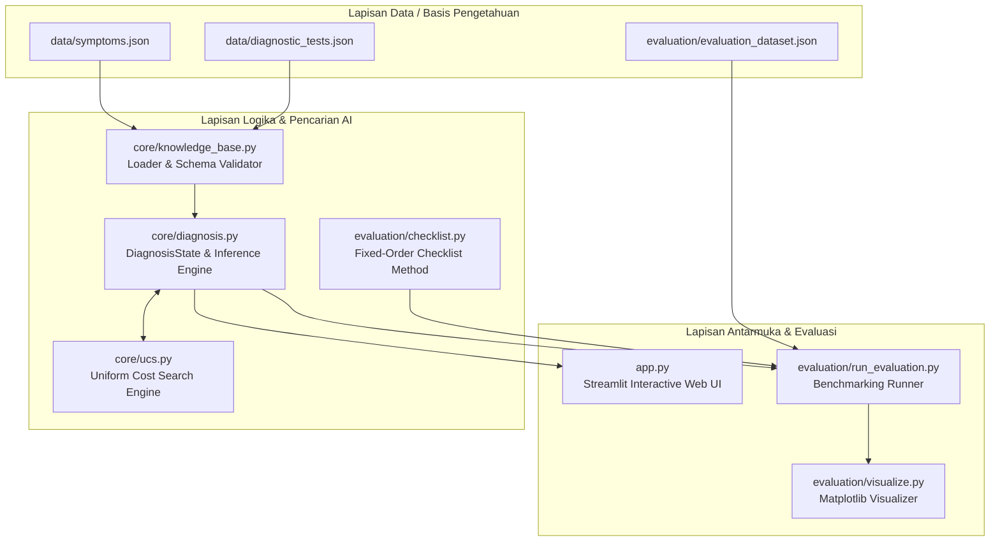
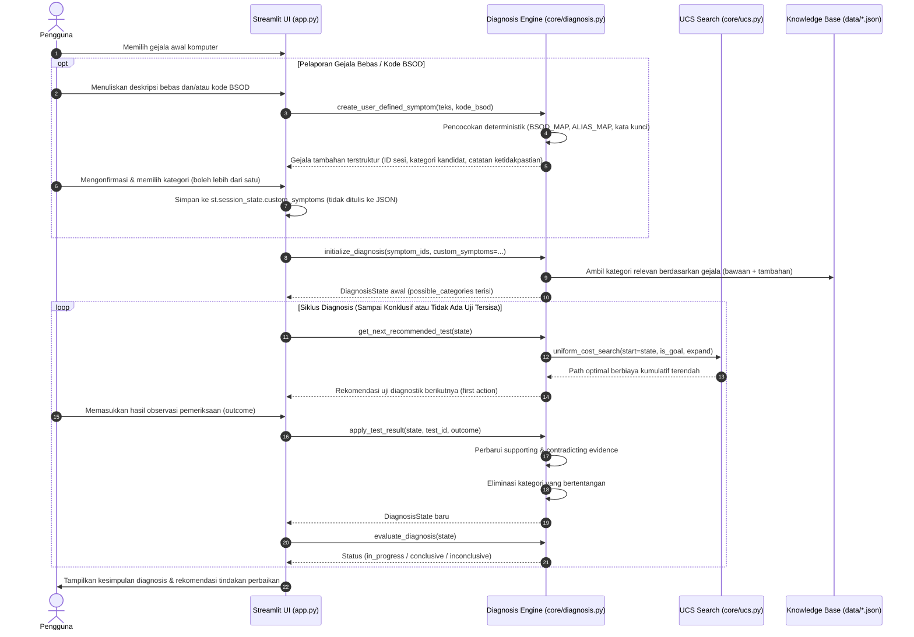

# DOKUMENTASI TEKNIS FINAL PROYEK UAS ARTIFICIAL INTELLIGENCE
## Asisten Diagnosis Masalah Komputer Berbasis Uniform Cost Search (UCS)

Dokumen ini merupakan laporan teknis komprehensif dan faktual mengenai arsitektur, implementasi algoritma, basis pengetahuan, antarmuka pengguna, serta hasil evaluasi eksperimental sistem **Asisten Diagnosis Masalah Komputer Berbasis Uniform Cost Search (UCS)**. Seluruh rincian teknis dan data kuantitatif yang disajikan bersumber langsung dari kode program dan hasil eksekusi pengujian pada repositori proyek.

---

## DAFTAR ISI
1. [Struktur Direktori dan Fungsi Komponen](#1-struktur-direktori-dan-fungsi-komponen)
2. [Arsitektur Sistem dan Alur Proses Diagnosis](#2-arsitektur-sistem-dan-alur-proses-diagnosis)
3. [Formulasi Masalah Pencarian dalam UCS](#3-formulasi-masalah-pencarian-dalam-ucs)
4. [Mekanisme Algoritma Uniform Cost Search (`core/ucs.py`)](#4-mekanisme-algoritma-uniform-cost-search-coreucspy)
5. [Prinsip Favourable Outcome dan Online Replanning](#5-prinsip-favourable-outcome-dan-online-replanning)
5A. [Konfirmasi Diagnosis dan Proteksi False-Positive](#5a-konfirmasi-diagnosis-dan-proteksi-false-positive)
6. [Struktur Basis Pengetahuan (Knowledge Base)](#6-struktur-basis-pengetahuan-knowledge-base)
7. [Desain Antarmuka Pengguna (Streamlit UI)](#7-desain-antarmuka-pengguna-streamlit-ui)
8. [Metodologi Evaluasi Eksperimental (UCS vs Fixed-Order Checklist)](#8-metodologi-evaluasi-eksperimental-ucs-vs-fixed-order-checklist)
9. [Verifikasi Hasil Pengujian dan Evaluasi Kuantitatif](#9-verifikasi-hasil-pengujian-dan-evaluasi-kuantitatif)
10. [Keterbatasan Penelitian Akademik](#10-keterbatasan-penelitian-akademik)

---

## 1. Struktur Direktori dan Fungsi Komponen

Proyek disusun dengan prinsip pemisahan tanggung jawab (*separation of concerns*) yang membedakan lapisan data, logika inti AI, antarmuka grafis, pengujian unit, serta modul evaluasi komparatif.

```text
AI-Computer-Diagnosis/
├── app.py                         # Antarmuka web interaktif berbasis Streamlit
├── requirements.txt               # Daftar dependensi eksternal (streamlit, pytest, matplotlib)
├── README.md                      # Dokumentasi publik proyek
├── DOKUMENTASI_TEKNIS_FINAL.md    # Dokumen teknis komprehensif untuk laporan akademik UAS
├── .gitignore                     # Pengecualian artefak runtime (.venv, cache, secrets)
├── .streamlit/
│   └── config.toml                # Tema Modern Tech Diagnostics (light + sidebar navy)
├── core/                          # Lapisan logika inti sistem cerdas
│   ├── __init__.py                # Inisialisasi paket core
│   ├── ucs.py                     # Implementasi algoritma Uniform Cost Search generik
│   ├── diagnosis.py               # Mesin inferensi, state space, dan transisi diagnosis
│   ├── knowledge_base.py          # Pemuat (loader) dan validator integritas skema JSON
│   ├── symptom_matcher.py         # Pencocokan teks deterministik + validasi kode BSOD
│   └── exceptions.py              # Definisi kelas eksepsi kustom sistem
├── data/                          # Lapisan basis pengetahuan (Knowledge Base)
│   ├── symptoms.json              # Definisi 4 kategori masalah dan 8 gejala awal
│   ├── diagnostic_tests.json      # Definisi 6 uji diagnostik, cost, dan pemetaan bukti
│   └── test_cases.json            # 4 skenario uji integrasi dasar sistem
├── tests/                         # Lapisan pengujian otomatis (automated unit testing)
│   ├── test_ucs.py                # 9 unit test untuk verifikasi algoritma UCS generik
│   ├── test_diagnosis.py          # 60 unit test untuk mesin diagnosis dan knowledge base
│   ├── test_symptom_matcher.py    # 13 unit test pencocokan teks dan validasi BSOD
│   ├── test_user_symptoms.py      # 13 unit test gejala tambahan & integrasi sesi
│   └── test_reset.py              # 13 unit test reset sesi & flag feedback UI
├── screenshots/                   # Tangkapan layar aplikasi aktual (multi-resolusi)
└── evaluation/                    # Modul evaluasi eksperimental komparatif
    ├── evaluation_dataset.json    # Dataset terstruktur 20 kasus uji simulasi
    ├── checklist.py               # Implementasi metode Fixed-Order Troubleshooting Checklist
    ├── run_evaluation.py          # Skrip eksekusi komparasi otomatis UCS vs Checklist
    ├── visualize.py               # Skrip pembuat grafik komparatif berbasis Matplotlib
    └── results/                   # Artefak luaran eksperimen
        ├── evaluation_report.json # Laporan lengkap hasil evaluasi dalam format JSON
        ├── results_per_case.csv   # Data evaluasi terperinci per kasus uji (CSV)
        ├── summary_metrics.csv    # Ringkasan metrik performa komparatif (CSV)
        ├── chart_average_cost.png # Grafik komparasi rata-rata total cost
        ├── chart_average_test_count.png # Grafik komparasi rata-rata jumlah uji
        ├── chart_outcomes.png     # Grafik distribusi luaran diagnosis
        ├── chart_cost_per_case.png # Grafik perbandingan cost tiap kasus
        └── chart_cost_per_category.png # Grafik rata-rata cost per kategori masalah
```

---

## 2. Arsitektur Sistem dan Alur Proses Diagnosis

Sistem mengadopsi arsitektur tiga lapis (*Three-Tier Architecture*):
1. **Data Layer**: Berisi file JSON yang merepresentasikan basis pengetahuan domain kerusakan komputer dan dataset pengujian.
2. **Logic & Search Layer**: Mesin diagnosis (`core/diagnosis.py`) yang berinteraksi dengan algoritma UCS (`core/ucs.py`) untuk menentukan langkah pemeriksaan optimal berbiaya minimum.
3. **Presentation & Evaluation Layer**: Antarmuka web Streamlit (`app.py`) untuk interaksi pengguna langsung serta runner evaluasi batch (`evaluation/run_evaluation.py`).

### Diagram Arsitektur Sistem



### Alur Proses Diagnosis Interaktif



---

## 3. Formulasi Masalah Pencarian dalam UCS

Pencarian langkah diagnosis diformulasikan sebagai permasalahan pencarian jalur terpendek berbasis biaya (*state space search*):

1. **State ($s$)**:
   Direpresentasikan secara formal melalui kelas `DiagnosisState` yang *immutable* (menggunakan tipe data `frozenset`):
   $$s = \langle S_{init}, T_{done}, R, E_{sup}, E_{contra}, E_{trust}, E_{mis}, C_{pos}, g \rangle$$
   - $S_{init}$: Himpunan gejala awal yang dipilih pengguna (`initial_symptoms`).
   - $T_{done}$: Himpunan ID pemeriksaan yang telah diselesaikan (`performed_tests`).
   - $R$: Himpunan pasangan terurut luaran pemeriksaan $(t, o)$ (`test_results`).
   - $E_{sup}$: Himpunan kunci bukti pendukung (`supporting_evidence`), mencakup bukti dari outcome normal, abnormal, maupun misleading.
   - $E_{contra}$: Himpunan kunci bukti yang bertentangan/kontradiksi (`contradicting_evidence`).
   - $E_{trust}$: Himpunan kunci bukti yang boleh dipakai sebagai **konfirmasi** (`trusted_support`), yaitu hanya bukti dari outcome non-misleading.
   - $E_{mis}$: Himpunan kunci bukti dari outcome **misleading** (`misleading_support`); berstatus indikasi awal, bukan konfirmasi.
   - $C_{pos}$: Himpunan kategori masalah yang masih relevan/mungkin (`possible_categories`).
   - $g$: Biaya kumulatif saat ini (`cumulative_cost`).

2. **Actions ($A(s)$)**:
   Aksi adalah pemilihan salah satu pemeriksaan diagnostik $t \in \text{available\_tests}(s)$ yang belum pernah dilakukan ($t \notin T_{done}$) dan relevan dengan kategori yang masih terbuka ($\text{category}(t) \in C_{pos}$).

3. **Transition Model ($T(s, a)$)**:
   Menerapkan hasil pemeriksaan $o$ ke state $s$ menghasilkan state baru $s'$ melalui metode `with_test_result(test_id, outcome)`:
   - $T_{done}' = T_{done} \cup \{t\}$
   - $R' = R \cup \{(t, o)\}$
   - $E_{sup}' = E_{sup} \cup \text{evidence\_mapping}[o].supports$
   - $E_{contra}' = E_{contra} \cup \text{evidence\_mapping}[o].contradicts$
   - Jika `outcome_type(o) == "misleading"`: $E_{mis}' = E_{mis} \cup \text{evidence\_mapping}[o].supports$ dan $E_{trust}' = E_{trust}$ (tidak bertambah).
   - Jika `outcome_type(o) == "uncertain"`: tidak ada bukti yang ditambahkan (dicatat di `neutral_evidence`).
   - Jika `outcome_type(o)` normal/abnormal: $E_{trust}' = E_{trust} \cup \text{evidence\_mapping}[o].supports$.
   - $C_{pos}' = \{ c \in C_{pos} \mid \text{evidence\_keys}(c) \cap E_{contra}' = \emptyset \}$
   - $g(s') = g(s) + \text{cost}(t)$

4. **Goal Test (`is_goal_state`)**:
   Suatu state $s$ dinyatakan mencapai tujuan (*goal state*) jika terdapat setidaknya satu kategori $c \in C_{pos}$ yang bukti **konfirmasinya** telah lengkap dan tidak memiliki bukti pertentangan:
   $$\text{is\_goal}(s) \iff \neg\,\text{conflict}(s) \land \exists c \in C_{pos} : (\text{required\_evidence}(c) \subseteq E_{trust}) \land (\text{required\_evidence}(c) \cap E_{contra} = \emptyset)$$
   Perhatikan bahwa syarat konfirmasi memakai $E_{trust}$, bukan $E_{sup}$. Bukti dari outcome misleading ($E_{mis}$) tidak pernah memenuhi goal test.

5. **Path Cost ($g(n)$)**:
   Fungsi biaya lintasan adalah akumulasi bobot biaya relatif dari setiap pemeriksaan yang dilakukan di sepanjang jalur pencarian:
   $$g(n) = \sum_{i=1}^{k} \text{cost}(t_i)$$
   Biaya ini merefleksikan tingkat disrupsi dan upaya teknis pemeriksaan (skala 1 hingga 5).

---

## 4. Mekanisme Algoritma Uniform Cost Search (`core/ucs.py`)

Algoritma UCS diimplementasikan pada modul `core/ucs.py` dengan komponen teknis utama sebagai berikut:

1. **Struktur Data Node (`SearchNode`)**:
   Didefinisikan sebagai dataclass dengan dekorator `@dataclass(order=True)`. Variabel pembanding utama adalah `total_cost` ($g(n)$). Variabel lainnya (`state`, `parent`, `action`) diberi parameter `compare=False` agar perbandingan hanya didasarkan pada biaya kumulatif.

2. **Priority Queue (`heapq`)**:
   Antrean prioritas diimplementasikan menggunakan min-heap standar Python (`heapq`). Setiap elemen antrean berupa tuple 3-elemen:
   $$\text{item} = (\text{total\_cost}, \text{tiebreaker}, \text{node})$$

3. **Mekanisme Tie-Breaker Deterministik**:
   Variabel integer counter `tiebreaker` dimulai dari $0$ dan bertambah secara monotonik setiap kali sebuah node baru dimasukkan ke dalam heap (`heappush`). Hal ini menjamin:
   - Tidak akan pernah terjadi pembandingan langsung antar objek `SearchNode` saat dua node memiliki biaya kumulatif yang identik.
   - Perilaku pencarian bersifat FIFO terhadap node dengan biaya sama, menghasilkan urutan penelusuran yang stabil dan sepenuhnya deterministik.

4. **Pengelolaan Explored State**:
   Menggunakan struktur data kamus (`explored: dict[State, float]`).
   - Menyimpan pemetaan `state -> best_known_cost`.
   - Node yang diambil dari antrean diperiksa: jika `current_cost > explored.get(state)`, node tersebut diabaikan (*pruned*) karena jalur yang lebih murah ke state tersebut telah dieksplorasi sebelumnya.
   - State baru dimasukkan ke antrean hanya jika belum pernah dieksplorasi atau jika ditemukan jalur dengan biaya yang lebih rendah (`new_cost < explored[next_state]`).

5. **Rekonstruksi Jalur (`reconstruct_path`)**:
   Setelah goal test terpenuhi, jalur penelusuran dibentuk kembali dengan merunut pointer `node.parent` mundur hingga mencapai akar (`parent is None`), kemudian membalikkan urutannya (`path.reverse()`) untuk menghasilkan urutan aksi $[(a_1, s_1), (a_2, s_2), \dots, (a_k, s_k)]$.

---

## 5. Prinsip Favourable Outcome dan Online Replanning

Dalam konteks diagnosis interaktif, terdapat perbedaan fundamental antara *pencarian jalur rencana* (komputasi internal) dan *proses diagnosis riil* (interaksi dengan manusia/sistem):

1. **Kebutuhan Asumsi Favourable Outcome**:
   Pada saat agen merencanakan langkah diagnostik berikutnya, agen belum mengetahui hasil observasi sebenarnya yang akan diberikan pengguna. Agar UCS dapat menemukan jalur menuju *goal state*, fungsi ekspansi `expand_state()` mengeksplorasi seluruh kemungkinan luaran yang terdaftar pada basis pengetahuan:
   ```python
   for test in available_tests:
       for outcome in test["possible_outcomes"]:
           next_state = state.with_test_result(test["id"], outcome)
           next_states.append((next_state, test["cost"], f"{test['id']}:{outcome}"))
   ```
   UCS akan secara alami memilih cabang dengan luaran yang membawa langsung ke konfirmasi kategori (*favourable outcome*) dengan total biaya termurah. Uji pertama dari rencana optimal ini (`path[1][0]`) diambil sebagai **rekomendasi uji berikutnya** (`get_next_recommended_test`).

2. **Mekanisme Online Replanning**:
   Aplikasi tidak mengeksekusi seluruh rencana masa depan secara buta. Sistem hanya merekomendasikan **satu pemeriksaan terdepan**.
   - Ketika pengguna memasukkan luaran observasi riil melalui `apply_test_result()`, state sistem diperbarui sesuai fakta sebenarnya.
   - Apabila luaran riil ternyata negatif/normal (kontradiksi), kategori terkait langsung dieliminasi dari `possible_categories`.
   - Pada siklus berikutnya, UCS dipanggil ulang dari state baru tersebut (*re-planning*) untuk mencari jalur optimal baru di antara kategori yang masih tersisa.

---

## 5A. Konfirmasi Diagnosis dan Proteksi False-Positive

Mekanisme konfirmasi dirancang agar sistem tidak menyimpulkan diagnosis final hanya dari indikasi awal yang berpotensi menyesatkan (*misleading outcome*).

### 5A.1. Supporting Evidence vs Confirmation Evidence

State membedakan tiga lapis bukti:

| Lapis | Field State | Sumber | Boleh Menjadi Dasar Diagnosis Final? |
| :--- | :--- | :--- | :---: |
| Bukti pendukung | `supporting_evidence` ($E_{sup}$) | Outcome normal, abnormal, dan misleading | Tidak (informatif) |
| Bukti konfirmasi | `trusted_support` ($E_{trust}$) | Outcome normal dan abnormal saja | Ya |
| Indikasi awal | `misleading_support` ($E_{mis}$) | Outcome misleading | Tidak |

`is_category_confirmed()` hanya memakai `trusted_support`. Konsekuensinya, satu outcome misleading tidak dapat sendirian menghasilkan diagnosis konklusif, tetapi tetap tercatat di `supporting_evidence` dan `misleading_support` agar transparan untuk pengguna.

### 5A.2. Penanganan Outcome Misleading

- Outcome bertipe `misleading` menambahkan evidence ke `supporting_evidence` **dan** `misleading_support`, tetapi **tidak** ke `trusted_support`.
- Goal test tetap `False` selama kategori terkait hanya memiliki bukti misleading, sehingga UCS melanjutkan ke pemeriksaan relevan berikutnya.
- Jika pemeriksaan lanjutan menghasilkan bukti independen yang konsisten (normal/abnormal), kategori dapat terkonfirmasi seperti biasa.
- Jika pemeriksaan lanjutan menghasilkan bukti bertentangan, kategori ditandai `conflicting` dan hasil akhirnya `inconclusive`.

### 5A.3. Outcome Uncertain

- Outcome bertipe `uncertain` (mis. `inconclusive`) tidak menambah `supporting_evidence` maupun `trusted_support`.
- Outcome tersebut dicatat pada `neutral_evidence` sebagai `(test_id, outcome)` dan tidak dianggap sebagai konfirmasi.
- Sistem tetap dapat melanjutkan ke pemeriksaan lain yang masih relevan.

### 5A.4. Kapan Sistem Melanjutkan Pemeriksaan

Selama masih terdapat pemeriksaan relevan di `possible_categories` (`get_available_tests()` tidak kosong) dan state belum mencapai goal test, UCS akan merekomendasikan pemeriksaan berikutnya. Ini berlaku juga ketika `trusted_support` belum terbentuk (mis. setelah outcome misleading atau uncertain).

### 5A.5. Kapan Sistem Berhenti Inconclusive

`evaluate_diagnosis()` mengembalikan status `inconclusive` ketika salah satu kondisi berikut terpenuhi:

1. Terdapat kategori dengan evidence internal yang bertentangan (`get_conflicting_categories()` tidak kosong).
2. Tidak ada pemeriksaan relevan yang tersisa (`get_pending_tests()` kosong) sementara tidak ada kategori yang terkonfirmasi lengkap.

Dengan aturan ini, sistem tidak memaksa diagnosis saat bukti tidak cukup; sistem berhenti secara aman dengan rekomendasi konsultasi teknisi.

### 5A.6. Keterbatasan Simulasi

- Mekanisme ini bergantung pada metadata `outcome_types` pada `data/diagnostic_tests.json` yang menandai setiap luaran sebagai `normal`, `abnormal`, `uncertain`, atau `misleading`.
- Sistem **tidak** dapat mendeteksi kebohongan alat ukur nyata. Jika sumber simulasi menandai outcome misleading sebagai abnormal, sistem akan memperlakukannya sebagai konfirmasi biasa.
- Pada evaluasi dataset extended yang dihasilkan otomatis, sebagian kasus kontradiktif punya luaran pembantah yang muncul setelah UCS mencapai goal state. Karena evaluasi memakai *early-stopping* UCS, bukti pembantah tersebut tidak pernah teramati. Kasus seperti ini dilaporkan sebagai *observation-limited conclusive* (bukan *false positive*), karena sistem tidak pernah menerima bukti yang bertentangan selama eksekusi.
- Penandaan `misleading` sepenuhnya bergantung pada asumsi kurator data, bukan verifikasi fisik perangkat keras.

---

## 6. Struktur Basis Pengetahuan (Knowledge Base)

Basis pengetahuan disimpan dalam format JSON terstandarisasi pada direktori `data/`.

### 6.1. Definisi 4 Kategori Masalah

| Kategori ID | Nama Kategori | Bukti Wajib (*Required Evidence*) | Rekomendasi Tindakan |
| :--- | :--- | :--- | :--- |
| `driver_software` | Driver dan perangkat lunak sistem | `driver_issue_confirmed` | Pembaruan driver via Device Manager / situs resmi produsen; Perbaikan file sistem via `sfc /scannow` dan `DISM`. |
| `overheating` | Overheating | `high_temperature_confirmed` | Pembersihan debu pada kipas dan heatsink; Penggantian thermal paste CPU/GPU; Pengecekan sirkulasi udara (*airflow*). |
| `storage_disk` | Storage dan disk | `disk_issue_confirmed` | Pencadangan (*backup*) data penting segera; Pemeriksaan bad sector via `chkdsk`; Penggantian drive jika S.M.A.R.T. rusak. |
| `ram_memory` | RAM dan memori | `memory_issue_confirmed` | Pengujian memori via Windows Memory Diagnostic / MemTest86; Pembersihan pin RAM; Pengujian modular per slot. |

### 6.2. Definisi 8 Gejala Awal

| Gejala ID | Nama Gejala | Kategori Terkait |
| :--- | :--- | :--- |
| `sym_bsod_driver` | BSOD dengan pesan error driver (seperti SYSTEM_SERVICE_EXCEPTION) | `driver_software` |
| `sym_device_manager_yellow` | Tanda seru kuning di Device Manager | `driver_software` |
| `sym_shutdown_thermal` | Komputer mati mendadak saat beban berat (game/rendering) | `overheating` |
| `sym_fan_loud_hot` | Kipas berputar kencang dan udara keluran terasa sangat panas | `overheating` |
| `sym_disk_slow_freeze` | Akses file sangat lambat atau Windows sering freeze | `storage_disk` |
| `sym_chkdsk_auto` | Windows otomatis menjalankan scan/repair disk saat boot | `storage_disk` |
| `sym_app_crash_random` | Aplikasi mendadak closed/crash secara acak tanpa pola | `ram_memory` |
| `sym_bsod_memory_management` | BSOD dengan pesan MEMORY_MANAGEMENT | `ram_memory` |

### 6.3. Definisi 6 Pemeriksaan Diagnostik dan Pemetaan Bukti

Setiap uji diagnostik memiliki bobot biaya relatif (*cost*) yang merepresentasikan tingkat disrupsi dan kompleksitas pengerjaannya:

| Uji ID | Nama Uji | Kategori | Cost | Kemungkinan Luaran (*Outcomes*) | Efek Bukti Pendukung (*Supports*) | Efek Bukti Kontradiksi (*Contradicts*) |
| :--- | :--- | :--- | :---: | :--- | :--- | :--- |
| `test_cpu_gpu_temp` | Cek suhu CPU/GPU | `overheating` | 1 | `normal`<br/>`elevated`<br/>`critical` | -<br/>`high_temperature_confirmed`<br/>`high_temperature_confirmed` | `high_temperature_confirmed`<br/>-<br/>- |
| `test_driver_status` | Cek status driver | `driver_software` | 2 | `all_ok`<br/>`yellow_bang`<br/>`error_code` | -<br/>`driver_issue_confirmed`<br/>`driver_issue_confirmed` | `driver_issue_confirmed`<br/>-<br/>- |
| `test_smart_disk` | Cek SMART disk | `storage_disk` | 2 | `healthy`<br/>`warning`<br/>`bad` | -<br/>`disk_issue_confirmed`<br/>`disk_issue_confirmed` | `disk_issue_confirmed`<br/>-<br/>- |
| `test_disk_system_error_logs` | Cek log error disk/sistem | `storage_disk` | 3 | `no_errors`<br/>`disk_errors_present` | -<br/>`disk_issue_confirmed` | `disk_issue_confirmed`<br/>- |
| `test_error_code_history` | Cek riwayat kode error | `driver_software` | 3 | `no_driver_errors`<br/>`driver_errors_found` | -<br/>`driver_issue_confirmed` | `driver_issue_confirmed`<br/>- |
| `test_memory_diagnostic` | Tes memori (butuh restart) | `ram_memory` | 5 | `no_errors`<br/>`errors_found` | -<br/>`memory_issue_confirmed` | `memory_issue_confirmed`<br/>- |

### 6.4. Gejala Tambahan dari Laporan Pengguna (*User-Defined Symptom*)

Selain 8 gejala bawaan, sistem dapat merumuskan **gejala tambahan terstruktur** dari deskripsi bebas dan/atau kode BSOD. Seluruh proses bersifat deterministik dan berbasis aturan (bukan ML/LLM):

1. **Perumusan** (`create_user_defined_symptom` pada `core/symptom_matcher.py`):
   - ID sesi stabil: `sym_user_{prefix}_{hash8}` dengan `hash8 = MD5(kode_bsod::teks)[:8]` sehingga laporan identik selalu menghasilkan ID yang sama.
   - Field yang dihasilkan: `id`, `name`, `description` (teks asli), `source="user_report"`, `error_code`, `related_categories`, `candidate_tests`, `uncertainty_notes`, `confirmed`.
   - Kode BSOD dan kata kunci hanya menghasilkan **kandidat kategori**; tidak pernah menjadi `supporting_evidence`.
2. **Pemetaan kode BSOD multi-kategori** (`BSOD_MAP`): satu kode dapat menghasilkan lebih dari satu kategori, misalnya `DPC_WATCHDOG_VIOLATION` → `driver_software` + `storage_disk`. Kode yang tidak dikenal mengembalikan `found=False` tanpa kategori (tidak dikarang).
3. **Konfirmasi pengguna**: kategori kandidat ditampilkan sebagai `st.multiselect` (dapat ditambah/dihapus). Tombol "Tambahkan ke Sesi Diagnosis" nonaktif bila tidak ada kategori dipilih. Saat dikonfirmasi, `related_categories` dan `candidate_tests` dihitung ulang dari kategori pilihan pengguna, lalu gejala disimpan di `st.session_state.custom_symptoms`.
4. **Integrasi ke UCS**: `initialize_diagnosis(symptom_ids, custom_symptoms=...)` menggabungkan gejala tambahan ke peta gejala valid, lalu mengisi `possible_categories` dari `related_categories`. UCS memilih pemeriksaan hanya dari kategori yang masih terbuka, dengan biaya kumulatif terendah; aturan bukti pendukung/kontradiktif tidak berubah.
5. **Persistensi**: gejala tambahan hanya hidup di `session_state` (runtime) dan **tidak ditulis** ke `data/*.json`. Reset sesi menghapus `custom_symptoms` dan `pending_custom_symptom`.
6. **Deskripsi di luar 4 kategori**: fungsi mengembalikan `success=False` beserta pesan bahwa aturan pemeriksaan belum tersedia. Tidak ada kategori/pemeriksaan yang difabrikasi.

Contoh pemetaan BSOD yang digunakan:

| Kode BSOD | Kandidat Kategori | Catatan |
| :--- | :--- | :--- |
| `DPC_WATCHDOG_VIOLATION` | `driver_software`, `storage_disk` | Driver sistem/storage atau masalah I/O disk. |
| `SYSTEM_SERVICE_EXCEPTION` | `driver_software` | Layanan sistem gagal, umumnya driver. |
| `CRITICAL_PROCESS_DIED` | `driver_software`, `storage_disk` | Proses kritis berhenti; periksa driver & drive. |
| `VIDEO_TDR_FAILURE` | `driver_software`, `overheating` | Driver GPU timeout atau GPU terlalu panas. |
| `MEMORY_MANAGEMENT` | `ram_memory` | Manajemen memori; umumnya modul RAM. |
| `PAGE_FAULT_IN_NONPAGED_AREA` | `ram_memory`, `storage_disk` | RAM atau paging file pada media storage. |
| `IRQL_NOT_LESS_OR_EQUAL` | `driver_software`, `ram_memory` | Driver mengakses memori pada IRQL salah. |
| `KERNEL_SECURITY_CHECK_FAILURE` | `driver_software`, `ram_memory` | Korupsi struktur kernel; driver/memori. |
| `WHEA_UNCORRECTABLE_ERROR` | `overheating`, `ram_memory` | Hardware error; suhu ekstrem atau RAM. |

---

## 7. Desain Antarmuka Pengguna (Streamlit UI)

Antarmuka pengguna pada `app.py` dibangun dengan panduan desain yang bersih dan informatif:

1. **Pemilihan Gejala Awal**:
   Pengguna memilih satu atau beberapa gejala awal melalui komponen `st.multiselect`. Terdapat tombol "Mulai Sesi Diagnosis" yang mengunci pemilihan gejala dan menginisialisasi state mesin diagnosis.
2. **Panel Deskripsi Bebas (*Free-Text Panel*)**:
   Panel ekspansibel untuk memasukkan deskripsi keluhan dan/atau kode BSOD. Sistem memproses input menjadi gejala tambahan terstruktur, menampilkan kandidat kategori (via `st.multiselect` multi-kategori), dan meminta konfirmasi pengguna sebelum gejala ditambahkan ke sesi.
3. **Panel Status dan Riwayat Sesi**:
   Menampilkan total biaya kumulatif (*cumulative cost*), jumlah tes yang telah diselesaikan, serta lencana (*badges*) bukti yang terkonfirmasi atau terbantahkan.
4. **Panel Rekomendasi Pemeriksaan Aktif**:
   Menampilkan rekomendasi uji berikutnya dari UCS lengkap dengan nilai biaya, deskripsi teknis, dan formulir radio button untuk memasukkan luaran observasi riil.
5. **Indikator Kecukupan Bukti (*Evidence Sufficiency*)**:
   - `sufficient` (Hijau): Tepat satu kategori terkonfirmasi.
   - `partial` (Kuning): Bukti belum cukup, masih ada pemeriksaan relevan yang tersedia.
   - `insufficient` (Merah): Seluruh pemeriksaan telah dijalankan namun tidak ada bukti pendukung konklusif.
   - `conflicting` (Merah): Lebih dari satu kategori saling bertentangan secara bersamaan.
6. **Panel Hasil Diagnosis dan Rekomendasi**:
   Menampilkan kartu status konklusif/inkonklusif dan daftar rekomendasi tindakan perbaikan praktis bagi pengguna.
7. **Mekanisme Reset Sesi dan Feedback Visual**:
   - **Tombol utama (halaman hasil)**: tombol **Mulai Diagnosis Baru** pada hasil diagnosis konklusif maupun inkonklusif melakukan reset **satu klik** melalui `start_new_diagnosis()` yang memanggil `clear_diagnosis_state()` secara terpusat. Pengguna langsung dikembalikan ke bagian identifikasi gejala tanpa perlu membuka sidebar.
   - **Kontrol sidebar (opsional)**: reset dari sidebar tetap memakai dialog konfirmasi **dua tahap** (perilaku pencegahan reset tidak sengaja dipertahankan).
   - **Reset terpusat**: `DIAGNOSIS_STATE_DEFAULTS`, `clear_diagnosis_state(store)`, dan `reset_diagnosis_session()` membersihkan seluruh state diagnosis (state aktif, gejala terpilih, log, hasil tes, evidence, kode BSOD, custom symptom, pending confirmation) serta key widget terkait, **tanpa** menghapus konfigurasi aplikasi.
   - **Feedback animasi**: setelah reset satu klik, `app.py` menampilkan transisi *processing* ("Menyiapkan sesi diagnosis baru...") lalu kartu sukses **"Sesi Diagnosis Baru Siap"** dengan animasi CSS ringan (fade-in, scale-in ikon centang, slide-up) dan dukungan `prefers-reduced-motion`. Flag UI `new_diagnosis_feedback` disimpan terpisah dari `DiagnosisState` (tidak memengaruhi UCS) dan dikonsumsi sekali pakai agar tidak muncul berulang.

---

## 8. Metodologi Evaluasi Eksperimental (UCS vs Fixed-Order Checklist)

Evaluasi eksperimental dirancang untuk membandingkan performa algoritma cerdas berbasis biaya (**Uniform Cost Search**) dengan pendekatan pemecahan masalah konvensional (**Fixed-Order Troubleshooting Checklist**).

### 8.1. Metode Pembanding: Fixed-Order Checklist
Checklist menggunakan urutan pemeriksaan tetap yang disusun berdasarkan kaidah teknisi konvensional: mengutamakan uji non-invasif berbiaya rendah terlebih dahulu sebelum beralih ke uji yang memerlukan restart sistem:
$$\text{Urutan Checklist} = [\text{cpu\_temp} (1) \rightarrow \text{driver\_status} (2) \rightarrow \text{smart\_disk} (2) \rightarrow \text{disk\_logs} (3) \rightarrow \text{error\_history} (3) \rightarrow \text{memory\_diag} (5)]$$
*Aturan Eksekusi Checklist*: Checklist hanya menjalankan pemeriksaan yang relevan dengan kategori yang saat itu masih mungkin (*possible categories*), dan langsung berhenti saat diagnosis telah mencapai status konklusif atau inkonklusif.

### 8.2. Struktur Dataset 20 Kasus Simulasi (`evaluation/evaluation_dataset.json`)
Dataset terdiri atas 20 kasus terstruktur yang mencakup 4 kategori masalah, kasus dengan bukti kontradiksi, serta kasus inkonklusif. Setiap kasus menyediakan luaran lengkap untuk seluruh pemeriksaan yang relevan agar pengujian kedua metode berjalan secara adil (*fair comparison*).

---

## 9. Verifikasi Hasil Pengujian dan Evaluasi Kuantitatif

Seluruh pengujian unit dan eksperimen evaluasi telah dijalankan ulang secara independen dan diverifikasi langsung dari kode sumber serta file luaran CSV/JSON.

### 9.1. Hasil Pengujian Unit Otomatis (pytest)
Perintah eksekusi:
```powershell
python -m pytest -v
```
**Hasil**: **108 passed** dari 108 skenario pengujian (tingkat kelulusan 100%, durasi ±2 detik).
- 9 pengujian pada `tests/test_ucs.py` memverifikasi ketepatan penemuan jalur minimum, penghindaran siklus, penanganan batas biaya, kestabilan SearchNode, dan ketercapaian goal.
- 60 pengujian pada `tests/test_diagnosis.py` memverifikasi integritas Knowledge Base, inisialisasi state, transisi bukti, akumulasi biaya, pencegahan eksekusi berulang, evaluasi konklusif/inkonklusif, proteksi misleading evidence, dan konfirmasi `trusted_support`.
- 13 pengujian pada `tests/test_symptom_matcher.py` memverifikasi pencocokan teks dan validasi kode BSOD.
- 13 pengujian pada `tests/test_user_symptoms.py` memverifikasi mekanisme gejala tambahan (pembuatan ID stabil, konfirmasi kategori, integrasi sesi, UCS multi-kategori).
- 13 pengujian pada `tests/test_reset.py` memverifikasi mekanisme reset sesi (pembersihan state terpusat, pengujian flag feedback UI, skenario reset pasca-diagnosis, isolasi antar sesi).

### 9.2. Tabel Hasil Per Kasus Simulasi (20 Kasus)

Tabel berikut bersumber langsung dari `evaluation/results/results_per_case.csv`:

| Case ID | Kategori Skenario | Expected Diagnosis / Status | Luaran UCS (Status/Outcome) | Luaran Checklist (Status/Outcome) | Cost UCS | Cost Checklist |
| :--- | :--- | :--- | :--- | :--- | :---: | :---: |
| `eval_oh_01` | `overheating` | `overheating` / conclusive | `overheating` / correct_conclusive | `overheating` / correct_conclusive | 1.0 | 1.0 |
| `eval_oh_02` | `overheating` | `overheating` / conclusive | `overheating` / correct_conclusive | `overheating` / correct_conclusive | 1.0 | 1.0 |
| `eval_oh_03` | `overheating` | `None` / inconclusive | `None` / correct_inconclusive | `None` / correct_inconclusive | 1.0 | 1.0 |
| `eval_oh_04` | `overheating` | `overheating` / conclusive | `overheating` / correct_conclusive | `overheating` / correct_conclusive | 1.0 | 1.0 |
| `eval_drv_01` | `driver_software` | `driver_software` / conclusive | `driver_software` / correct_conclusive | `driver_software` / correct_conclusive | 2.0 | 2.0 |
| `eval_drv_02` | `driver_software` | `driver_software` / conclusive | `driver_software` / correct_conclusive | `driver_software` / correct_conclusive | 2.0 | 2.0 |
| `eval_drv_03` | `driver_software` | `None` / inconclusive | `None` / correct_inconclusive | `None` / correct_inconclusive | 2.0 | 2.0 |
| `eval_drv_04` | `driver_software` | `driver_software` / conclusive | `driver_software` / correct_conclusive | `driver_software` / correct_conclusive | 4.0 | 2.0 |
| `eval_stg_01` | `storage_disk` | `storage_disk` / conclusive | `storage_disk` / correct_conclusive | `storage_disk` / correct_conclusive | 2.0 | 2.0 |
| `eval_stg_02` | `storage_disk` | `storage_disk` / conclusive | `storage_disk` / correct_conclusive | `storage_disk` / correct_conclusive | 2.0 | 2.0 |
| `eval_stg_03` | `storage_disk` | `None` / inconclusive | `None` / correct_inconclusive | `None` / correct_inconclusive | 2.0 | 2.0 |
| `eval_stg_04` | `storage_disk` | `storage_disk` / conclusive | `storage_disk` / correct_conclusive | `storage_disk` / correct_conclusive | 2.0 | 2.0 |
| `eval_ram_01` | `ram_memory` | `ram_memory` / conclusive | `ram_memory` / correct_conclusive | `ram_memory` / correct_conclusive | 5.0 | 5.0 |
| `eval_ram_02` | `ram_memory` | `None` / inconclusive | `None` / correct_inconclusive | `None` / correct_inconclusive | 5.0 | 5.0 |
| `eval_ram_03` | `ram_memory` | `ram_memory` / conclusive | `ram_memory` / correct_conclusive | `ram_memory` / correct_conclusive | 7.0 | 7.0 |
| `eval_mixed_01` | `driver_software` | `driver_software` / conclusive | `driver_software` / correct_conclusive | `driver_software` / correct_conclusive | 3.0 | 3.0 |
| `eval_mixed_02` | `storage_disk` | `storage_disk` / conclusive | `storage_disk` / correct_conclusive | `storage_disk` / correct_conclusive | 2.0 | 4.0 |
| `eval_mixed_03` | `overheating` | `overheating` / conclusive | `overheating` / correct_conclusive | `overheating` / correct_conclusive | 1.0 | 1.0 |
| `eval_mixed_04` | `storage_disk` | `storage_disk` / conclusive | `storage_disk` / correct_conclusive | `storage_disk` / correct_conclusive | 2.0 | 4.0 |
| `eval_mixed_05` | `mixed` | `None` / inconclusive | `None` / correct_inconclusive | `None` / correct_inconclusive | 9.0 | 9.0 |

### 9.3. Tabel Ringkasan Metrik Komparatif

Tabel berikut bersumber langsung dari `evaluation/results/summary_metrics.csv` dan `evaluation/results/evaluation_report.json`:

| Indikator Kuantitatif Evaluasi | Uniform Cost Search (UCS) | Fixed-Order Checklist | Selisih / Analisis |
| :--- | :---: | :---: | :---: |
| **Total Kasus Pengujian** | 20 | 20 | Identik |
| **Diagnosis Konklusif Sesuai Label** | 15 kasus | 15 kasus | Identik |
| **Inkonklusif Sesuai Label** | 5 kasus | 5 kasus | Identik |
| **Salah Diagnosis (*Incorrect Conclusive*)** | 0 kasus | 0 kasus | Identik |
| **Kasus Konklusif Terlewat (*Missed Conclusive*)** | 0 kasus | 0 kasus | Identik |
| **Hasil Negatif Palsu (*False Negative*, diturunkan dari *missed conclusive*)** | 0 kasus | 0 kasus | Identik |
| **Hasil Positif Palsu (*False Positive*, bukti kontradiktif benar-benar teramati)** | 0 kasus | 0 kasus | Identik |
| **Konklusif Terbatas Observasi (*Observation-Limited Conclusive*)** | 0 kasus | 0 kasus | Identik |
| **Tingkat Akurasi terhadap Label Simulasi (*Overall Correct Rate*)** | **100.00%** | **100.00%** | Keduanya konsisten dengan basis aturan |
| **Rata-rata Cumulative Cost (Seluruh 20 Kasus)** | **2.80** | **2.90** | UCS lebih hemat 0.10 poin biaya |
| **Rata-rata Cost Kasus Konklusif (15 Kasus)** | **2.47** | **2.60** | UCS lebih hemat 0.13 poin biaya |
| **Rata-rata Jumlah Pemeriksaan per Kasus** | **1.25** | **1.30** | UCS membutuhkan langkah lebih sedikit |
| **Kasus Label Kontradiksi yang Berakhir Inkonklusif** | **5 / 13** | **5 / 13** | Kontradiksi teramati pada 5 kasus |
| **Kontradiksi Teramati yang Berakhir Inkonklusif** | **5 / 8** | **5 / 9** | Sistem menolak menyimpulkan saat konflik teramati |
| **Konsistensi Bukti Aktual terhadap Expected** | **20 / 20 (100%)** | **20 / 20 (100%)** | Bukti yang dihasilkan sepenuhnya valid |

### 9.4. Analisis Perbedaan Performa
- **Keunggulan Efisiensi UCS**: Pada kasus multi-gejala seperti `eval_mixed_02` dan `eval_mixed_04`, UCS mampu langsung mengidentifikasi pemeriksaan disk (`test_smart_disk`, cost 2) sebagai jalur optimal termurah, sedangkan Checklist yang memiliki urutan kaku terlebih dahulu menguji status driver (`test_driver_status`, cost 2) sebelum memeriksa disk, sehingga Checklist menghabiskan total cost 4.0 berbanding UCS yang hanya 2.0.
- **Kondisi Tie-Breaker**: Pada kasus `eval_drv_04` (kombinasi gejala driver dan disk yang keduanya memiliki uji berbiaya 2), UCS mendahulukan pemeriksaan disk karena urutan pendaftaran pengujian dalam list, menghabiskan cost 4.0, sedangkan checklist secara kebetulan mendahulukan driver (cost 2.0). Secara agregat pada 20 kasus, UCS tetap unggul dalam efisiensi rata-rata biaya (2.80 vs 2.90).

### 9.5. Evaluasi Dataset Extended dan Gabungan

Selain dataset baseline 20 kasus, evaluasi juga dijalankan pada dataset extended 180 kasus simulasi (`data/extended_dataset.json`, label `development:true`, `source_type:expert_curated`) dan dataset gabungan 200 kasus. Seluruh angka dihitung dari eksekusi `python -m evaluation.run_evaluation_all`.

| Indikator | Baseline (20) UCS | Extended (180) UCS | Combined (200) UCS | Combined (200) Checklist |
| :--- | :---: | :---: | :---: | :---: |
| Kasus label konklusif | 15 | 93 | 108 | 108 |
| Kasus label inkonklusif | 5 | 87 | 92 | 92 |
| Hasil aktual konklusif | 15 | 122 | 137 | 137 |
| Hasil aktual inkonklusif | 5 | 58 | 63 | 63 |
| Correct conclusive | 15 | 92 | 107 | 107 |
| Incorrect conclusive (salah diagnosis) | 0 | 0 | 0 | 0 |
| Correct inconclusive | 5 | 57 | 62 | 62 |
| Missed conclusive (menjadi inkonklusif) | 0 | 1 | 1 | 1 |
| False negative (turunan *missed conclusive*) | 0 | 1 | 1 | 1 |
| False positive (kontradiksi benar-benar teramati) | 0 | 0 | 0 | 0 |
| Observation-limited conclusive | 0 | 30 | 30 | 30 |
| Total hasil sesuai label | 20 | 149 | 169 | 169 |
| Coverage (hasil konklusif / total kasus) | 75.00% | 67.78% | 68.50% | 68.50% |
| Accuracy among conclusive (label) | 100.00% | 75.41% | 78.10% | 78.10% |
| Accuracy among evaluable conclusive | 100.00% | 100.00% | 100.00% | 100.00% |
| Overall correct rate | 100.00% | 82.78% | 84.50% | 84.50% |
| Overall correct rate (evaluable) | 100.00% | 99.33% | 99.41% | 99.41% |
| Rata-rata total cost | 2.80 | 6.83 | 6.42 | 6.31 |
| Rata-rata cost label konklusif | 2.47 | 4.45 | 4.18 | 4.18 |
| Rata-rata cost hasil konklusif | 2.47 | 4.66 | 4.42 | 4.43 |
| Rata-rata jumlah pemeriksaan | 1.25 | 2.82 | 2.66 | 2.54 |
| Kasus label kontradiksi berakhir inkonklusif | 5/13 | 1/31 | 6/44 | 6/44 |
| Kasus label kontradiksi tanpa kontradiksi teramati | 5 | 30 | 35 | 34 |
| Bukti konsisten | 20/20 | 172/180 | 192/200 | 192/200 |

Catatan penting:

1. **Satu *missed conclusive* pada `EXT_DRV_045` adalah hasil yang diharapkan** dari mekanisme konfirmasi baru. Kasus misleading ini sebelumnya berhenti konklusif secara prematur hanya karena outcome `test_driver_status=false_positive`; setelah `is_category_confirmed()` mewajibkan `trusted_support`, sistem menolak menyimpulkan dan berhenti `inconclusive`. Label `expected` sengaja tidak diubah sesuai batasan tugas, sehingga kasus ini dihitung sebagai *missed conclusive* (dan *false negative* turunannya). Perilaku sistem sudah benar; label dataset yang mempertahankan ekspektasi lama.
2. **Tidak ada *false positive* (0 kasus)** pada seluruh dataset. Sebanyak 30 kasus extended yang sebelumnya dilaporkan sebagai *false positive* kini diklasifikasikan sebagai **observation-limited conclusive**: luaran pembantah berada pada pemeriksaan yang tidak pernah dipilih UCS karena *early-stopping* goal test, sehingga sistem tidak pernah mengamati kontradiksi tersebut. Ini menegaskan bahwa mekanisme konfirmasi tidak gagal ketika konflik benar-benar masuk ke `DiagnosisState`.
3. **Tidak ada salah diagnosis** (`incorrect_conclusive = 0`) pada seluruh dataset. Seluruh hasil konklusif yang tidak sesuai label berupa kasus *observation-limited conclusive*, bukan diagnosis kategori yang salah.
4. **`false_negative` bukan lagi bucket utama**, melainkan metrik turunan dari *missed conclusive*. Kasus inkonklusif yang sesuai label tidak boleh dihitung sebagai false negative.

### 9.6. Definisi Operasional Metrik Evaluasi

Setiap kasus dipetakan ke tepat satu bucket berikut (mutually exclusive):

| Bucket | Kondisi | Perlakuan Metrik |
| :--- | :--- | :--- |
| `correct_conclusive` | Label konklusif, hasil konklusif, diagnosis sama | Benar |
| `incorrect_conclusive` | Label konklusif, hasil konklusif, diagnosis beda | Salah diagnosis |
| `correct_inconclusive` | Label inkonklusif, hasil inkonklusif | Benar (bukan false negative) |
| `missed_conclusive` | Label konklusif, hasil inkonklusif | Menjadi dasar `false_negative` |
| `false_positive` | Label inkonklusif, hasil konklusif, bukti kontradiktif benar-benar teramati | Positif palsu sejati |
| `observation_limited_conclusive` | Label inkonklusif, hasil konklusif, bukti kontradiktif hanya ada pada tes yang tidak pernah dieksekusi | Dikecualikan dari denominator akurasi evaluable |

Metrik turunan:

- `coverage = actual_conclusive_cases / cases_total`
- `accuracy_among_conclusive_label = correct_conclusive / actual_conclusive_cases`
- `accuracy_among_evaluable_conclusive = correct_conclusive / (correct_conclusive + incorrect_conclusive + false_positive)`
- `overall_correct_rate = correct_total / cases_total`
- `overall_correct_rate_evaluable = correct_total / (cases_total - observation_limited_conclusive)`
- `false_negative_rate = missed_conclusive / expected_conclusive_cases`
- `false_positive_rate = false_positive / expected_inconclusive_cases`

`evaluation/results/summary_metrics.csv` memakai `overall_correct_rate` sebagai nilai kolom `accuracy`. Nilai tersebut sah untuk perbandingan antar-metode, tetapi tidak boleh ditafsirkan sebagai akurasi diagnosis klinis.

---

## 10. Keterbatasan Penelitian Akademik

Penyusunan laporan UAS wajib mencantumkan batasan-batasan ilmiah berikut secara jujur dan transparan:

1. **Lingkungan Uji Terbatas pada Simulasi Diskrit**:
   Dataset evaluasi terdiri atas 20 kasus simulasi buatan yang dirancang untuk menguji kelengkapan cabang inferensi. Oleh karena itu, **capaian akurasi 100% adalah ukuran konsistensi logis mesin inferensi terhadap aturan basis pengetahuan**, bukan bukti validitas atau akurasi diagnosis pada komputer fisik di dunia nyata.
2. **Ketiadaan Uji Signifikansi Inferensial**:
   Meskipun UCS mencatat rata-rata biaya kumulatif lebih rendah (2.80 vs 2.90) dan jumlah tes lebih sedikit (1.25 vs 1.30), selisih ini merupakan statistik deskriptif pada sampel $N=20$. Penelitian ini belum melakukan uji hipotesis statistik inferensial (seperti *paired t-test* atau *Wilcoxon signed-rank test*) untuk menyatakan bahwa perbedaan tersebut signifikan secara statistik.
3. **Penyederhanaan Bobot Biaya (*Relative Cost*)**:
   Nilai biaya (skala 1–5) merupakan estimasi kemudahan relatif yang ditetapkan secara deterministik oleh pengembang, bukan hasil pengukuran durasi waktu nyata (detik/menit) atau beban finansial perbaikan teknis.
4. **Cakupan Ruang Masalah (*Domain Scope*)**:
   Sistem dibatasi secara ketat hanya pada 4 kategori kegagalan sistem Windows dengan 6 jenis pemeriksaan diagnostik. Kerusakan perangkat keras lain seperti catu daya (*Power Supply*), kerusakan jalur motherboard, infeksi malware kompleks, atau kerusakan firmware/BIOS berada di luar jangkauan sistem ini.
5. **Gejala Tambahan Berbasis Sesi (*User-Defined Symptoms*)**:
   Sistem merumuskan gejala secara deterministik dari teks bebas/BSOD. Data ini hanya bersifat *runtime* (session-scoped) dan akan terhapus setelah sesi berakhir atau direset, sehingga tidak ditulis ke basis pengetahuan jangka panjang secara permanen.
6. **Ketergantungan pada Kategori yang Dikonfirmasi**:
   Kualitas rekomendasi pemeriksaan UCS pada gejala tambahan sangat bergantung pada ketepatan kategori yang dipilih pengguna saat konfirmasi. Jika pengguna memilih kategori yang kurang tepat, sistem mungkin merekomendasikan pemeriksaan yang kurang relevan dengan akar masalah fisik sesungguhnya.
