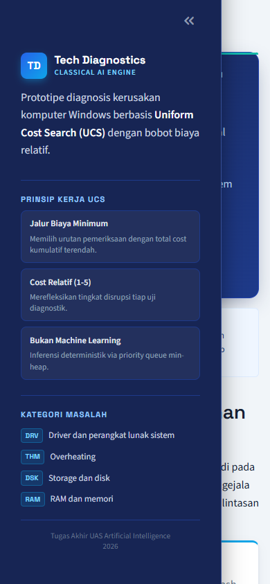

# Asisten Diagnosis Masalah Komputer Berbasis Uniform Cost Search (UCS)


Aplikasi pakar diagnostik interaktif untuk mengidentifikasi akar permasalahan sistem operasi Windows menggunakan pendekatan **Classical Artificial Intelligence** dan algoritma pencarian graf berbasis biaya **Uniform Cost Search (UCS)**. Proyek ini dikembangkan sebagai tugas akhir / UAS mata kuliah Artificial Intelligence.

---

## 📋 Daftar Isi
- [Tentang Proyek](#-tentang-proyek)
- [Fitur Utama](#-fitur-utama)
- [Tangkapan Layar Aplikasi](#-tangkapan-layar-aplikasi)
- [Teknologi yang Digunakan](#-teknologi-yang-digunakan)
- [Cara Kerja Algoritma Uniform Cost Search](#-cara-kerja-algoritma-uniform-cost-search)
- [Arsitektur dan Struktur Folder](#-arsitektur-dan-struktur-folder)
- [Instalasi dan Menjalankan Aplikasi](#-instalasi-dan-menjalankan-aplikasi)
- [Pengujian Otomatis](#-pengujian-otomatis)
- [Hasil Evaluasi Eksperimental](#-hasil-evaluasi-eksperimental)
- [Keterbatasan Sistem](#-keterbatasan-sistem)
- [Pengembangan Selanjutnya](#-pengembangan-selanjutnya)
- [Lisensi](#-lisensi)

---

## 📌 Tentang Proyek

### Latar Belakang
Troubleshooting komputer sering kali membingungkan pengguna awam karena banyaknya kemungkinan penyebab. Metode konvensional seperti *fixed-order checklist* cenderung kaku—menguji setiap langkah tanpa memperhitungkan tingkat kesulitan atau biaya disrupsi pemeriksaan.

### Tujuan Aplikasi
Sistem ini dibangun untuk membantu pengguna memetakan gejala kerusakan awal menuju rekomendasi pemeriksaan yang **efisien secara biaya kumulatif**, tanpa memerlukan koneksi internet, model Machine Learning, atau eksekusi perintah berbahaya ke sistem operasi.

### 4 Kategori Masalah Utama
1. **Driver & Perangkat Lunak Sistem (`driver_software`)**: Masalah driver, ketidakcocokan software, atau BSOD terkait driver.
2. **Overheating / Suhu Berlebih (`overheating`)**: Suhu komponen CPU/GPU melebihi ambang batas operasional aman.
3. **Storage & Disk (`storage_disk`)**: Kerusakan fisik/logis disk, bad sector, atau penurunan kesehatan S.M.A.R.T.
4. **RAM & Memori (`ram_memory`)**: Kerusakan modul memori fisik, ketidakstabilan RAM, atau memory leak.

### Mengapa Classical AI & Uniform Cost Search?
- **Deterministik & Transparan**: Keputusan diagnostik murni berbasis aturan dan pohon pencarian diskrit, dapat dilacak dari akar hingga kesimpulan tanpa sifat *black-box*.
- **Optimalitas Biaya**: UCS menjamin penemuan lintasan menuju konfirmasi diagnosis dengan total *cumulative cost* terendah $g(n)$, mengutamakan pengujian yang mudah dan tidak invasif terlebih dahulu.

---

## ✨ Fitur Utama

- **Identifikasi Gejala Multi-Kategori**: Pengguna dapat memilih satu atau beberapa gejala awal dari basis pengetahuan.
- **Empat Kategori Diagnosis Spesifik**: Mencakup Driver, Overheating, Storage/Disk, dan RAM/Memori.
- **Analisis Deskripsi Bebas (Deterministik)**: Pencocokan kata kunci dan kode error deterministik dari kalimat keluhan pengguna.
- **Custom Symptom (Session-Scoped)**: Pengguna dapat menambahkan gejala kustom yang secara otomatis dipetakan ke kategori relevan dalam scope sesi.
- **Validasi Kode BSOD**: Deteksi otomatis kode Blue Screen (seperti `0x00000023`, `FAT_FILE_SYSTEM`), termasuk peringatan jika terdapat konflik antara nama BSOD dan kode heksadesimalnya.
- **Multi-Category Selection**: Pengkonfirmasian kategori yang diinginkan untuk gejala kustom sebelum pencarian UCS dimulai.
- **Mesin Pencarian UCS (`heapq`)**: Priority queue berbasis min-heap untuk menghitung lintasan pemeriksaan berbiaya minimum.
- **Rekomendasi Berdasarkan Cumulative Cost**: Setiap pengujian memiliki bobot disrupsi (skala 1–5). UCS merekomendasikan uji yang efisien terlebih dahulu.
- **Kesimpulan Konklusif & Inkonklusif**: Menghasilkan diagnosis konklusif jika tepat satu kategori terbukti, atau inkonklusif jika bukti tidak cukup/bertentangan (tanpa estimasi palsu).
- **Rekomendasi Perbaikan Manual**: Menampilkan petunjuk perbaikan praktis yang aman bagi pengguna.
- **Riwayat Langkah & Transisi State**: Rekaman lengkap setiap pemeriksaan, luaran observasi, dan perubahan biaya kumulatif.
- **Reset Diagnosis Satu Klik**: Tombol *Mulai Diagnosis Baru* terpusat yang membersihkan seluruh state sesi.
- **Feedback Visual & Animasi Antarmuka**: Transisi CSS modern (spinner loading ringan, kartu sukses dengan animasi scale-in, slide-up section, dan dukungan `prefers-reduced-motion`).

---

## 🖼️ Tangkapan Layar Aplikasi

File screenshot aktual tersimpan dalam direktori `screenshots/`:

| Tampilan Utama Desktop (1920x1080) | Tampilan Laptop (1366x768) |
| :---: | :---: |
|  |  |

| Tampilan Tablet (768x1024) | Tampilan Mobile Drawer (390x844) |
| :---: | :---: |
|  |  |

### Daftar Screenshot yang Tersedia di Repositori:
- `screenshots/align_1920x1080.png`: Layar utama desktop resolusi FHD.
- `screenshots/align_1536x864.png`: Tampilan layar laptop standar 15 inci.
- `screenshots/align_1366x768.png`: Tampilan resolusi populer laptop 14 inci.
- `screenshots/align_1024x768.png`: Tampilan iPad / Tablet landscape.
- `screenshots/align_768x1024.png`: Tampilan Tablet portrait.
- `screenshots/align_390x844.png`: Tampilan Smartphone / Mobile portrait.
- `screenshots/mobile_drawer_open.png`: Tampilan antarmuka mobile dengan sidebar aktif.

---

## 🛠️ Teknologi yang Digunakan

| Teknologi | Fungsi dalam Proyek |
| :--- | :--- |
| **Python 3.10+** | Bahasa pemrograman utama untuk logika bisnis dan algoritma pencarian |
| **Streamlit (1.40+)** | Framework antarmuka web interaktif berbasis komponen murni Python |
| **`heapq` (Python standard library)** | Priority queue min-heap untuk mengeksekusi Uniform Cost Search secara efisien |
| **JSON Data Files** | Penyimpanan basis pengetahuan terstruktur (`symptoms.json`, `diagnostic_tests.json`) |
| **pytest** | Framework otomatisasi pengujian unit (80 test case passing) |
| **Matplotlib** | Pembuat grafik komparatif hasil evaluasi eksperimental |

---

## ⚙️ Cara Kerja Algoritma Uniform Cost Search

### Formulasi Masalah Pencarian
1. **State (`DiagnosisState`)**: Struktur data *immutable* (`frozenset`) yang merepresentasikan:
   - `initial_symptoms`: Himpunan ID gejala awal.
   - `performed_tests`: Himpunan ID pemeriksaan yang sudah dilakukan.
   - `test_results`: Pasangan `(test_id, outcome)` luaran observasi.
   - `supporting_evidence`: Bukti pendukung terkonfirmasi.
   - `contradicting_evidence`: Bukti bertentangan.
   - `possible_categories`: Kategori yang masih terbuka.
   - `cumulative_cost`: Total biaya kumulatif $g(n)$.
2. **Goal Test (`is_goal_state`)**: State dianggap goal jika tepat satu kategori memiliki seluruh bukti pendukung yang disyaratkan tanpa ada bukti bertentangan.
3. **Fungsi Ekspansi (`expand_state`)**: Generasi state berikutnya dengan mensimulasikan seluruh luaran yang mungkin dari pemeriksaan diagnostik yang belum pernah dijalankan pada kategori yang masih terbuka.
4. **Priority Queue (`heapq`)**: Node disimpan sebagai tuple `(total_cost, tiebreaker, SearchNode)` untuk menjamin eksplorasi cabang berbiaya terendah.
5. **Explored Set (`explored`)**: Menyimpan `best_known_cost` per state untuk menghindari revisit lintasan yang lebih mahal.
6. **Tie-Breaker Deterministik**: Penggunaan counter integer bertahap (`tiebreaker += 1`) untuk mencegah error komparasi objek saat biaya bernilai sama.
7. **Parent Pointer & Rekonstruksi Jalur**: Setiap `SearchNode` menyimpan referensi `parent`. Setelah goal tercapai, `reconstruct_path` merunut mundur hingga *start node* dan membalikkan hasilnya.
8. **Online Replanning**: Setelah pengguna memasukkan hasil observasi aktual, state sistem diperbarui dan UCS mengeksekusi pencarian ulang secara otomatis dari state terbaru.

### Contoh Alur Kerja Sederhana

```
Start State: Gejala awal = ["sym_fan_loud_hot"] -> Possible: [overheating]
├── Uji A: test_cpu_gpu_temp (cost 1) -> Branch outcomes: [normal, elevated, critical]
│   ├── outcome='elevated' -> cumulative_cost = 1 -> Goal (overheating confirmed) [Optimal Path]
└── Uji B: test_driver_status (cost 2) -> cumulative_cost = 2 (Lebih mahal, dieksplorasi belakangan)
```

---

## 📂 Arsitektur dan Struktur Folder

```text
AI-Computer-Diagnosis/
├── app.py                         # Antarmuka web interaktif Streamlit
├── requirements.txt               # Dependensi proyek
├── README.md                      # Dokumentasi publik GitHub
├── DOKUMENTASI_TEKNIS_FINAL.md    # Dokumentasi teknis komprehensif UAS
├── .gitignore                     # Konfigurasi pengabaian Git (.venv, cache)
├── .streamlit/
│   └── config.toml                # Tema visual Modern Tech Diagnostics
├── core/                          # Logika inti Classical AI
│   ├── __init__.py
│   ├── ucs.py                     # Algoritma Uniform Cost Search generik (heapq)
│   ├── diagnosis.py               # State space, goal test, dan ekspansi diagnosis
│   ├── knowledge_base.py          # Loader & validator skema JSON
│   ├── symptom_matcher.py         # Pencocokan kata kunci deterministik & validasi BSOD
│   └── exceptions.py              # Eksepsi kustom sistem
├── data/                          # Basis Pengetahuan (Knowledge Base)
│   ├── symptoms.json              # 4 kategori & 8 gejala bawaan
│   ├── diagnostic_tests.json      # 6 uji diagnostik, cost, & pemetaan bukti
│   └── test_cases.json            # 4 skenario uji integrasi dasar
├── tests/                         # Pengujian Unit Otomatis (80 Tests)
│   ├── test_ucs.py                # 9 unit test algoritma UCS
│   ├── test_diagnosis.py          # 32 unit test mesin diagnosis
│   ├── test_symptom_matcher.py    # 13 unit test matcher & BSOD
│   ├── test_user_symptoms.py      # 13 unit test custom symptoms & sesi
│   └── test_reset.py              # 13 unit test reset sesi & feedback UI
├── screenshots/                   # Bukti tangkapan layar antarmuka
└── evaluation/                    # Modul Eksperimen Komparatif
    ├── evaluation_dataset.json    # Dataset 20 kasus simulasi
    ├── checklist.py               # Metode pembanding (Fixed-Order Checklist)
    ├── run_evaluation.py          # Runner evaluasi eksperimental batch
    ├── visualize.py               # Pembuat grafik komparatif Matplotlib
    └── results/                   # Grafik PNG & Laporan JSON/CSV
```

---

## 🚀 Instalasi dan Menjalankan Aplikasi

Panduan menggunakan **Windows PowerShell**:

```powershell
# 1. Clone repositori ini
git clone https://github.com/rohmad656/AI-Computer-Diagnosis.git
cd AI-Computer-Diagnosis

# 2. Buat virtual environment
python -m venv .venv

# 3. Aktifkan virtual environment
.\.venv\Scripts\Activate.ps1

# 4. Perbarui pip dan instal dependensi
python -m pip install --upgrade pip
pip install -r requirements.txt

# 5. Jalankan aplikasi Streamlit
streamlit run app.py
```

Aplikasi akan otomatis terbuka di browser Anda pada alamat `http://localhost:8501`.

---

## 🧪 Pengujian Otomatis

Proyek ini dilengkapi dengan **80 unit test otomatis** menggunakan `pytest` yang menguji seluruh lapisan logika inti, algoritma UCS, validasi BSOD, dan isolasi sesi.

### Jalankan Kompilasi & Unit Test:
```powershell
# Verifikasi kompilasi sintaks
python -m py_compile app.py core/*.py evaluation/*.py

# Jalankan pengujian unit
python -m pytest -v
```

### Hasil Pengujian Otomatis Terakhir:
- **`tests/test_diagnosis.py`**: 32 passed
- **`tests/test_reset.py`**: 13 passed
- **`tests/test_symptom_matcher.py`**: 13 passed
- **`tests/test_user_symptoms.py`**: 13 passed
- **`tests/test_ucs.py`**: 9 passed
- **TOTAL**: **80 / 80 PASSED** (100% kelulusan, durasi ~0.5s)

---

## 📊 Hasil Evaluasi Eksperimental

Eksperimen dilakukan dengan membandingkan **Uniform Cost Search (UCS)** melawan metode pembanding **Fixed-Order Troubleshooting Checklist** pada dataset 20 kasus simulasi (`evaluation/evaluation_dataset.json`).

### Menjalankan Evaluasi Eksperimental:
```powershell
python -m evaluation.run_evaluation
```

### Ringkasan Hasil Evaluasi:

| Indikator Evaluasi | Uniform Cost Search (UCS) | Fixed-Order Checklist |
| :--- | :---: | :---: |
| **Total Kasus Simulasi** | 20 | 20 |
| **Diagnosis Konklusif Sesuai Label** | 15 | 15 |
| **Inkonklusif Sesuai Label** | 5 | 5 |
| **Salah Diagnosis / Misclassification** | 0 | 0 |
| **Akurasi Diagnostik terhadap Label** | **100.00%** | **100.00%** |
| **Rata-rata Cumulative Cost (Seluruh Kasus)** | **2.80** | **2.90** |
| **Rata-rata Cumulative Cost (Kasus Konklusif)** | **2.47** | **2.60** |
| **Rata-rata Jumlah Pemeriksaan** | **1.25** | **1.30** |
| **Ketahanan terhadap Bukti Bertentangan** | 13 / 13 kasus (100%) | 13 / 13 kasus (100%) |
| **Konsistensi Bukti Aktual vs Expected** | 20 / 20 kasus (100%) | 20 / 20 kasus (100%) |

### Catatan Penting Hasil Evaluasi:
1. **Kasus Simulasi Terstruktur**: Evaluasi dijalankan pada 20 kasus terdefinisi. Akurasi 100% menunjukkan integritas penegakan aturan deterministik pada basis pengetahuan, bukan klaim performa di dunia nyata.
2. **Skala Biaya Relatif (Cost 1–5)**: Bobot biaya merefleksikan tingkat disrupsi/upaya teknis relatif (misal: Cek suhu = 1, Restart tes RAM = 5), bukan durasi waktu riil detik/menit.
3. **Efisiensi UCS**: UCS terbukti lebih efisien (rata-rata cost 2.80 vs 2.90) pada skenario multi-gejala karena secara adaptif memilih pengujian termurah yang relevan.
4. **Cakupan Basis Pengetahuan**: Seluruh hasil terbatas pada ruang masalah dan aturan yang didefinisikan dalam `data/*.json`.

---

## ⚠️ Keterbatasan Sistem

- **Sistem Berbasis Aturan & Kata Kunci**: Menggunakan logika aturan deterministik dan pencocokan teks sederhana. Tidak menggunakan model bahasa besar (LLM) atau Natural Language Processing (NLP) tingkat lanjut.
- **Bukan Machine Learning**: Tidak melakukan pelatihan model probabilistik dari data historis.
- **Terbatas 4 Kategori**: Diagnosis terbatas pada masalah Driver, Overheating, Storage/Disk, dan RAM/Memori.
- **Custom Symptom Session-Scoped**: Gejala kustom pengguna hanya tersimpan dalam memori sesi runtime (`st.session_state`) dan tidak permanen ke file JSON.
- **Tanpa Eksekusi Perintah Otomatis**: Sistem tidak mengubah registry, tidak mengeksekusi perintah terminal Windows, dan tidak menginstal driver secara otomatis.
- **Ketergantungan Observasi Pengguna**: Ketepatan kesimpulan sangat bergantung pada keakuratan luaran pemeriksaan yang dimasukkan oleh pengguna.

---

## 🔮 Pengembangan Selanjutnya

- **Ekspansi Basis Pengetahuan**: Menambahkan kategori diagnosis baru (misal: Power Supply / PSU, Kartu Grafis Dedicated, Jaringan / Network Interface Card).
- **Perbandingan Algoritma Pencarian Cerdas Lain**: Membandingkan performa UCS dengan algoritma terinformasi seperti A* Search atau IDA* menggunakan fungsi heuristik.
- **Ekspor Laporan Diagnostik**: Fitur mengunduh ringkasan hasil diagnosis dan riwayat pemeriksaan dalam format PDF atau JSON.
- **Modul Parser Log Windows (Offline)**: Fitur pembaca file log sistem Windows (`.evtx` / `.log`) secara parsial untuk pengisian luaran observasi otomatis.

---

## 📄 Lisensi

Lisensi untuk proyek ini belum ditentukan (*Unlicensed / Academic Use Only*). Hak cipta dimiliki oleh pengembang proyek untuk keperluan akademik UAS Artificial Intelligence 2026.
