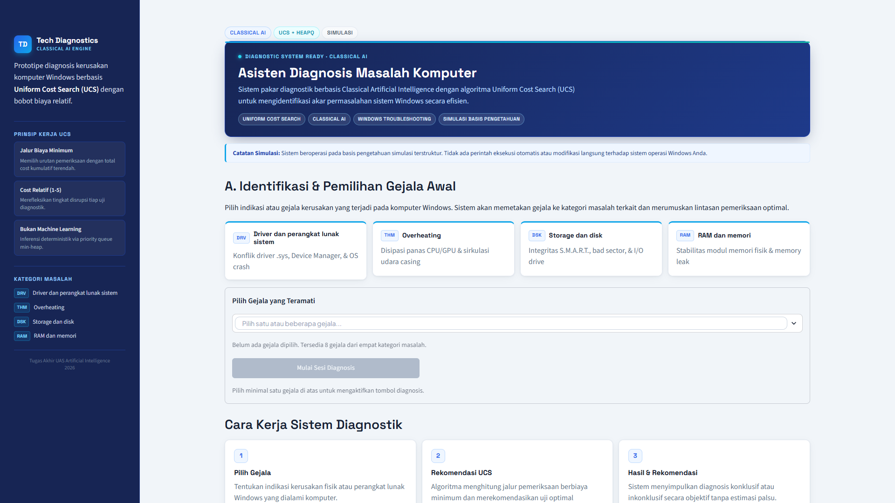
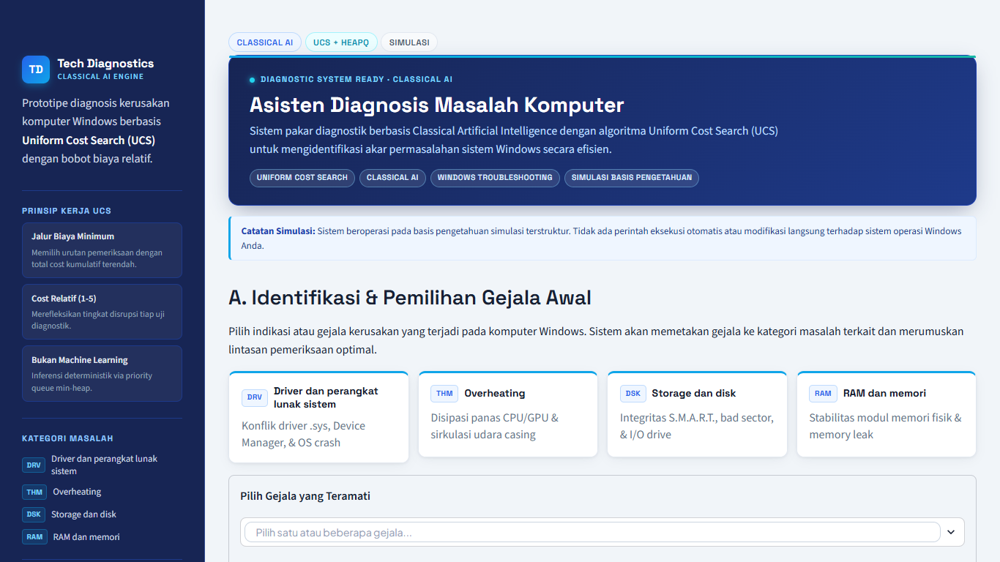
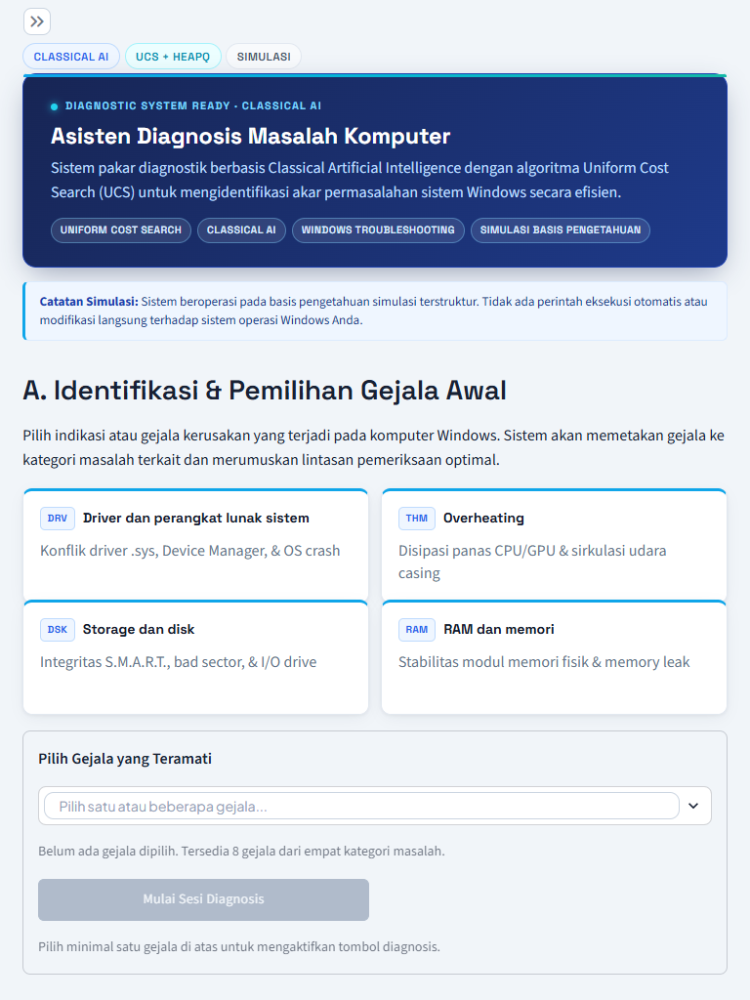
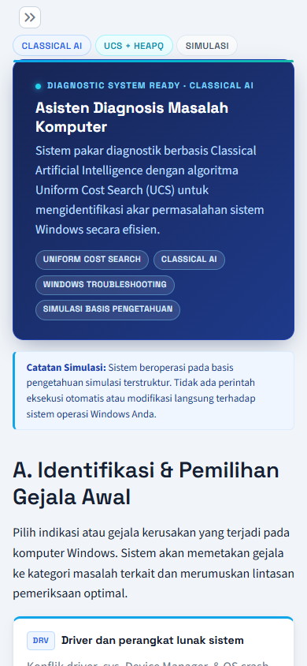

# AI Computer Diagnosis


Aplikasi sistem pakar diagnosis awal masalah komputer berbasis web menggunakan algoritma **Uniform Cost Search (UCS)**. Aplikasi membantu pengguna mengidentifikasi kemungkinan masalah komputer berdasarkan gejala dan hasil pemeriksaan yang dipilih secara interaktif.

Aplikasi dikembangkan menggunakan **Python** dan **Streamlit**, dengan basis pengetahuan terstruktur dalam berkas JSON. Seluruh keputusan diagnosis dihasilkan secara deterministik dari aturan dan pencarian graf berbasis biaya, tanpa model Machine Learning dan tanpa eksekusi perintah berbahaya ke sistem operasi.

---

## Daftar Isi

- [A. Judul dan Deskripsi Proyek](#a-judul-dan-deskripsi-proyek)
- [B. Latar Belakang dan Tujuan](#b-latar-belakang-dan-tujuan)
- [C. Fitur Utama](#c-fitur-utama)
- [D. Kategori Diagnosis](#d-kategori-diagnosis)
- [E. Algoritma Uniform Cost Search](#e-algoritma-uniform-cost-search)
- [F. Mekanisme Diagnosis dan Evidence](#f-mekanisme-diagnosis-dan-evidence)
- [G. Teknologi yang Digunakan](#g-teknologi-yang-digunakan)
- [H. Struktur Direktori](#h-struktur-direktori)
- [I. Persyaratan dan Instalasi](#i-persyaratan-dan-instalasi)
- [J. Cara Menjalankan Pengujian dan Evaluasi](#j-cara-menjalankan-pengujian-dan-evaluasi)
- [K. Hasil Evaluasi](#k-hasil-evaluasi)
- [L. Dokumentasi Teknis](#l-dokumentasi-teknis)
- [M. Screenshots](#m-screenshots)
- [N. Batasan Sistem](#n-batasan-sistem)
- [O. Informasi Pengembangan](#o-informasi-pengembangan)

---

## A. Judul dan Deskripsi Proyek

**AI Computer Diagnosis** adalah aplikasi pakar diagnosis awal untuk masalah komputer Windows. Pengguna memilih gejala awal, sistem memetakan gejala tersebut ke kategori masalah yang mungkin, lalu merekomendasikan pemeriksaan diagnostik berikutnya berdasarkan biaya kumulatif terendah. Setelah pengguna memasukkan hasil pemeriksaan aktual, sistem memperbarui kondisi diagnosis dan menentukan apakah diagnosis sudah konklusif, masih memerlukan pemeriksaan lain, atau harus berhenti secara inkonklusif.

Aplikasi ini merupakan proyek akademik bidang **Artificial Intelligence** yang berfokus pada penerapan **Classical AI**, khususnya algoritma pencarian **Uniform Cost Search**.

---

## B. Latar Belakang dan Tujuan

### Latar Belakang

Pengguna awam sering kali kesulitan menentukan penyebab awal kerusakan komputer. Gejala seperti BSOD, komputer mati mendadak, atau sistem terasa lambat dapat berasal dari beberapa kategori masalah yang berbeda. Pendekatan *fixed-order checklist* juga cenderung kaku karena menjalankan pemeriksaan dengan urutan yang sama tanpa mempertimbangkan tingkat kesulitan atau gangguan setiap pemeriksaan.

### Tujuan

- Membantu pengguna memetakan gejala awal menuju kemungkinan kategori masalah komputer.
- Merekomendasikan pemeriksaan berikutnya secara adaptif berdasarkan akumulasi biaya.
- Menjaga transparansi bukti: setiap dukungan, kontradiksi, dan hasil yang tidak meyakinkan tercatat di dalam state diagnosis.
- Menolak menyimpulkan diagnosis ketika bukti belum cukup atau saling bertentangan.

### Batasan Sejak Awal

Aplikasi ini adalah **alat bantu diagnosis awal**, bukan alat perbaikan otomatis. Aplikasi tidak memeriksa perangkat keras secara langsung dan tidak menjalankan tindakan perbaikan pada komputer pengguna. Seluruh hasil bergantung pada gejala dan hasil pemeriksaan yang dimasukkan pengguna.

---

## C. Fitur Utama

Fitur berikut benar-benar tersedia di dalam source code:

- **Diagnosis interaktif berbasis gejala**: pengguna memilih gejala awal dari basis pengetahuan.
- **Identifikasi kategori masalah komputer**: driver/software, overheating, storage/disk, dan RAM/memori.
- **Uniform Cost Search (`heapq`)**: pencarian jalur pemeriksaan dengan biaya kumulatif minimum.
- **Pemilihan pemeriksaan berdasarkan biaya**: setiap pemeriksaan memiliki bobot biaya relatif 1–5.
- **Pembaruan kondisi diagnosis secara online**: hasil pemeriksaan aktual yang dimasukkan pengguna langsung memperbarui state dan memicu perencanaan ulang.
- **Penanganan contradictory evidence**: kategori dieliminasi ketika bukti yang bertentangan muncul.
- **Penanganan uncertain outcome**: hasil `inconclusive` dicatat sebagai bukti netral, bukan dukungan maupun kontradiksi.
- **Perlindungan terhadap misleading outcome**: outcome bertipe *misleading* tidak boleh menjadi satu-satunya dasar diagnosis konklusif.
- **Diagnosis inkonklusif yang aman**: sistem berhenti tanpa memaksakan diagnosis ketika bukti tidak cukup.
- **Pencocokan gejala dari deskripsi bebas**: pencocokan kata kunci deterministik.
- **Validasi kode BSOD**: pengenalan nama BSOD dan kode heksadesimal, termasuk peringatan jika nama dan kode tidak konsisten.
- **Gejala kustom berbasis sesi**: gejala tambahan disimpan di `st.session_state` dan dipetakan ke kategori yang dipilih pengguna.
- **Pencegahan pemeriksaan berulang**: satu pemeriksaan hanya boleh dijalankan sekali dalam satu sesi diagnosis.
- **Riwayat langkah dan transisi state**: setiap pemeriksaan, outcome, dan biaya kumulatif ditampilkan.
- **Reset diagnosis satu klik**: membersihkan state sesi secara terpusat.
- **Evaluasi algoritma dan dataset**: membandingkan UCS dengan *Fixed-Order Checklist* pada dataset baseline, extended, dan combined.
- **Pengujian otomatis dengan pytest**: 108 unit test.
- **Visualisasi hasil evaluasi**: grafik Matplotlib untuk biaya, jumlah pemeriksaan, dan bucket outcome.

---

## D. Kategori Diagnosis

| Kategori | ID | Bukti Wajib Konfirmasi | Contoh Gejala |
| :--- | :--- | :--- | :--- |
| Driver dan perangkat lunak sistem | `driver_software` | `driver_issue_confirmed` | BSOD terkait driver, tanda seru kuning di Device Manager |
| Overheating | `overheating` | `high_temperature_confirmed` | Mati mendadak saat beban berat, kipas berputar kencang |
| Storage dan disk | `storage_disk` | `disk_issue_confirmed` | Akses file lambat, freeze, `chkdsk` otomatis saat boot |
| RAM dan memori | `ram_memory` | `memory_issue_confirmed` | Aplikasi crash acak, BSOD `MEMORY_MANAGEMENT` |

Kategori dan bukti wajib didefinisikan di `data/symptoms.json`. Pemetaan outcome pemeriksaan ke bukti didefinisikan di `data/diagnostic_tests.json`.

---

## E. Algoritma Uniform Cost Search

### Konsep

Uniform Cost Search (UCS) adalah algoritma pencarian *uninformed* yang selalu mengeksplorasi node dengan biaya kumulatif paling rendah. UCS tidak memakai heuristic; prioritas node hanya ditentukan oleh biaya jalur dari kondisi awal.

Rumus prioritas:

```text
f(n) = g(n)
```

Keterangan:

- `g(n)` adalah akumulasi biaya dari kondisi awal menuju node saat ini.
- UCS memilih node dengan nilai `g(n)` terkecil.
- Tidak ada estimasi `h(n)` karena UCS tidak menggunakan heuristic.

### Implementasi di Proyek

Implementasi generik berada di `core/ucs.py`:

1. **Priority queue `heapq`** menyimpan tuple `(total_cost, tiebreaker, node)`.
2. **Tiebreaker** berupa counter integer yang selalu bertambah. Tujuannya menjaga urutan node tetap stabil ketika dua node memiliki biaya sama, sekaligus menghindari perbandingan objek state yang tidak mendukung ordering.
3. **Explored set** menyimpan biaya terbaik yang diketahui untuk setiap state agar lintasan yang lebih mahal tidak dieksplorasi ulang.
4. **Goal test** disediakan sebagai fungsi predikat. Pada diagnosis, goal tercapai ketika ada kategori yang terkonfirmasi oleh `trusted_support` dan tidak memiliki konflik bukti.
5. **Rekonstruksi jalur** dilakukan dengan menelusuri parent pointer dari node tujuan hingga start node, lalu membalikkan urutan hasilnya.
6. **Online replanning** dilakukan setiap kali pengguna memasukkan hasil pemeriksaan. State diperbarui, lalu UCS dijalankan ulang dari state terbaru untuk menentukan pemeriksaan berikutnya.

### Arti Biaya

Biaya pemeriksaan merupakan **representasi relatif dari usaha atau tingkat gangguan pemeriksaan**, bukan durasi waktu aktual dan bukan probabilitas kerusakan. Contoh: cek suhu bernilai 1 karena cepat dan non-invasif, sedangkan Windows Memory Diagnostic bernilai 5 karena memerlukan restart dan waktu lebih lama.

### Fungsi Ekspansi Diagnosis

`expand_state()` menghasilkan state baru untuk setiap pemeriksaan yang masih relevan dan setiap outcome yang mungkin dari pemeriksaan tersebut. Setiap transisi menambahkan biaya pemeriksaan ke `cumulative_cost`. Pemeriksaan yang sudah pernah dilakukan tidak dimasukkan lagi ke dalam daftar pemeriksaan yang tersedia.

---

## F. Mekanisme Diagnosis dan Evidence

### Lapisan Bukti

`DiagnosisState` memisahkan bukti menjadi beberapa field:

| Field | Isi | Boleh Menjadi Dasar Konfirmasi? |
| :--- | :--- | :---: |
| `supporting_evidence` | Seluruh bukti pendukung, termasuk dari outcome misleading | Tidak (informatif) |
| `trusted_support` | Bukti pendukung dari outcome normal dan abnormal | Ya |
| `misleading_support` | Bukti yang hanya berasal dari outcome misleading | Tidak |
| `contradicting_evidence` | Bukti yang menolak kategori | Tidak; dapat mengeliminasi kategori |
| `neutral_evidence` | Pasangan `(test_id, outcome)` dari outcome uncertain | Tidak |

### Aturan Konfirmasi (Phase 13)

- `is_category_confirmed()` hanya memakai `trusted_support`.
- Outcome **misleading** menambah `supporting_evidence` dan `misleading_support`, tetapi **tidak** menambah `trusted_support`.
- Satu outcome misleading tidak dapat sendirian menghasilkan diagnosis konklusif. UCS akan melanjutkan ke pemeriksaan relevan berikutnya.
- Outcome **uncertain** tidak menambah bukti pendukung maupun kontradiktif. Hasilnya dicatat di `neutral_evidence`.
- Jika bukti pendukung dan kontradiktif untuk kategori yang sama muncul bersamaan, kategori ditandai **conflicting**.
- Kategori dieliminasi dari `possible_categories` ketika bukti kontradiktifnya muncul.
- Pemeriksaan yang sudah pernah dijalankan tidak boleh diulang; pelanggaran ini menghasilkan `InvalidStateError`.
- Sistem berhenti `inconclusive` jika terdapat konflik bukti atau tidak ada pemeriksaan relevan yang tersisa.

### Status Evaluasi

- `conclusive`: tepat satu kategori terkonfirmasi oleh `trusted_support` dan tidak ada konflik.
- `inconclusive`: terdapat konflik bukti, atau seluruh pemeriksaan relevan habis tanpa konfirmasi.
- `in_progress`: masih ada pemeriksaan relevan yang dapat dilakukan (status antara di dalam mesin diagnosis).

---

## G. Teknologi yang Digunakan

| Teknologi | Fungsi |
| :--- | :--- |
| **Python 3.10+** | Bahasa pemrograman utama; diuji pada Python 3.14.10 |
| **Streamlit** | Antarmuka web interaktif berbasis Python |
| **Uniform Cost Search** | Algoritma pencarian jalur pemeriksaan berbiaya minimum |
| **`heapq`** | Priority queue min-heap untuk UCS |
| **JSON** | Penyimpanan basis pengetahuan, dataset, dan laporan evaluasi |
| **pytest** | Pengujian unit otomatis (108 test) |
| **Matplotlib** | Visualisasi grafik hasil evaluasi |
| **Git** | Version control dan distribusi repositori |

Proyek ini **tidak** menggunakan framework Machine Learning, LLM, database server, atau API eksternal.

---

## H. Struktur Direktori

```text
AI-Computer-Diagnosis/
├── app.py                          # Antarmuka Streamlit
├── requirements.txt                # Dependensi Python
├── README.md                       # Panduan publik proyek
├── DOKUMENTASI_TEKNIS_FINAL.md     # Dokumentasi teknis komprehensif
├── .gitignore                      # Pengabaian Git
├── .streamlit/
│   └── config.toml                 # Konfigurasi tema Streamlit
├── core/                           # Logika inti sistem pakar
│   ├── __init__.py
│   ├── ucs.py                      # Implementasi generik Uniform Cost Search
│   ├── diagnosis.py                # State diagnosis, goal test, evidence, dan ekspansi
│   ├── knowledge_base.py           # Loader dan validator basis pengetahuan JSON
│   ├── symptom_matcher.py          # Pencocokan gejala dan validasi kode BSOD
│   └── exceptions.py               # Eksepsi kustom
├── data/                           # Basis pengetahuan dan dataset
│   ├── symptoms.json               # Kategori, gejala, dan rekomendasi
│   ├── diagnostic_tests.json       # Pemeriksaan, biaya, outcome, dan evidence mapping
│   ├── test_cases.json             # Skenario uji integrasi dasar
│   └── extended_dataset.json       # Dataset extended 180 kasus simulasi
├── evaluation/                     # Modul evaluasi eksperimental
│   ├── evaluation_dataset.json     # Dataset baseline 20 kasus
│   ├── checklist.py                # Metode pembanding Fixed-Order Checklist
│   ├── run_evaluation.py           # Mesin evaluasi dan klasifikasi outcome
│   ├── run_evaluation_all.py       # Runner baseline / extended / combined
│   ├── validate_dataset.py         # Validator integritas dataset
│   ├── generate_extended_dataset.py# Generator dataset extended
│   ├── visualize.py                # Pembuat grafik evaluasi
│   └── results/                    # Laporan JSON/CSV dan grafik PNG
├── tests/                          # 108 unit test pytest
│   ├── test_ucs.py
│   ├── test_diagnosis.py
│   ├── test_symptom_matcher.py
│   ├── test_user_symptoms.py
│   └── test_reset.py
├── screenshots/                    # Tangkapan layar antarmuka
└── assets/                         # Aset statis (placeholder `images/`)
```

Fungsi direktori utama:

- `core/`: seluruh logika Classical AI, state diagnosis, UCS, dan basis pengetahuan.
- `data/`: sumber kebenaran aturan diagnosis dan dataset simulasi.
- `evaluation/`: eksperimen komparatif UCS vs Fixed-Order Checklist beserta laporan.
- `tests/`: pengujian unit untuk algoritma, matcher, sesi, dan reset.
- `screenshots/`: bukti visual antarmuka pada beberapa resolusi.
- `assets/`: tempat aset gambar statis; saat ini belum berisi aset yang dipakai aplikasi.
- `.streamlit/`: konfigurasi tema dan tampilan Streamlit.

---

## I. Persyaratan dan Instalasi

### Persyaratan

- Python 3.10 atau lebih baru (diuji pada Python 3.14.10)
- `pip`
- Git
- Windows PowerShell (contoh perintah di bawah), atau shell lain dengan penyesuaian aktivasi virtual environment

### Langkah Instalasi

```powershell
# 1. Clone repository
git clone https://github.com/rohmad656/AI-Computer-Diagnosis.git
cd AI-Computer-Diagnosis

# 2. Buat virtual environment
python -m venv .venv

# 3. Aktifkan virtual environment
.\.venv\Scripts\Activate.ps1

# 4. Install dependencies
python -m pip install --upgrade pip
pip install -r requirements.txt

# 5. Jalankan aplikasi
streamlit run app.py
```

Aplikasi akan terbuka di browser pada alamat `http://localhost:8501`.

Jika PowerShell menolak aktivasi skrip, jalankan perintah berikut satu kali lalu ulangi aktivasi:

```powershell
Set-ExecutionPolicy -Scope CurrentUser RemoteSigned
```

---

## J. Cara Menjalankan Pengujian dan Evaluasi

Semua perintah dijalankan dari root proyek dengan virtual environment aktif.

### 1. Unit Test

```powershell
python -m pytest -q
```

Untuk melihat nama setiap test:

```powershell
python -m pytest -v
```

Hasil terakhir: **108 passed**.

### 2. Validasi Dataset

```powershell
# Validasi seluruh dataset (baseline + extended + combined)
python -m evaluation.validate_dataset

# Validasi salah satu dataset saja
python -m evaluation.validate_dataset --baseline
python -m evaluation.validate_dataset --extended
python -m evaluation.validate_dataset --combined
```

### 3. Evaluasi Baseline (20 kasus)

```powershell
python -m evaluation.run_evaluation_all --mode baseline
```

Output: `evaluation/results/baseline/`

### 4. Evaluasi Extended (180 kasus)

```powershell
python -m evaluation.run_evaluation_all --mode extended
```

Output: `evaluation/results/extended/`

### 5. Evaluasi Combined (200 kasus)

```powershell
python -m evaluation.run_evaluation_all --mode combined
```

Output default: `evaluation/results/`

Direktori output dapat diubah:

```powershell
python -m evaluation.run_evaluation_all --mode combined --output-dir evaluation/results/combined
```

### 6. Grafik Evaluasi

```powershell
python -m evaluation.visualize
```

Grafik dibaca dari `evaluation/results/evaluation_report.json` dan ditulis ke `evaluation/results/chart_*.png`.

---

## K. Hasil Evaluasi

Evaluasi membandingkan **UCS** dengan **Fixed-Order Checklist** pada tiga dataset simulasi:

- **Baseline**: 20 kasus (`evaluation/evaluation_dataset.json`)
- **Extended**: 180 kasus (`data/extended_dataset.json`)
- **Combined**: 200 kasus (gabungan baseline dan extended)

Seluruh angka berikut berasal dari eksekusi terbaru dan tersimpan di `evaluation/results/*/summary_metrics.csv`.

### Definisi Bucket Outcome

Setiap kasus dipetakan ke tepat satu bucket:

| Bucket | Kondisi |
| :--- | :--- |
| `correct_conclusive` | Label konklusif, hasil konklusif, diagnosis sama |
| `incorrect_conclusive` | Label konklusif, hasil konklusif, diagnosis berbeda |
| `correct_inconclusive` | Label inkonklusif, hasil inkonklusif |
| `missed_conclusive` | Label konklusif, hasil inkonklusif; menjadi dasar `false_negative` |
| `false_positive` | Label inkonklusif, hasil konklusif, dan bukti kontradiktif benar-benar teramati |
| `observation_limited_conclusive` | Label inkonklusif, hasil konklusif, tetapi bukti kontradiktif hanya ada pada pemeriksaan yang tidak pernah dieksekusi |

`false_negative` bukan bucket terpisah; nilainya diturunkan langsung dari `missed_conclusive`.

### Hasil UCS

| Metrik | Baseline (20) | Extended (180) | Combined (200) |
| :--- | ---: | ---: | ---: |
| Kasus label konklusif | 15 | 93 | 108 |
| Kasus label inkonklusif | 5 | 87 | 92 |
| Correct conclusive | 15 | 92 | 107 |
| Incorrect conclusive | 0 | 0 | 0 |
| Correct inconclusive | 5 | 57 | 62 |
| Missed conclusive / false negative | 0 | 1 | 1 |
| False positive (kontradiksi teramati) | 0 | 0 | 0 |
| Observation-limited conclusive | 0 | 30 | 30 |
| Total hasil sesuai label | 20 | 149 | 169 |
| Coverage | 75.00% | 67.78% | 68.50% |
| Accuracy among conclusive (label) | 100.00% | 75.41% | 78.10% |
| Accuracy among evaluable conclusive | 100.00% | 100.00% | 100.00% |
| Overall correct rate | 100.00% | 82.78% | 84.50% |
| Overall correct rate (evaluable) | 100.00% | 99.33% | 99.41% |
| Rata-rata total cost | 2.80 | 6.83 | 6.42 |
| Rata-rata cost label konklusif | 2.47 | 4.45 | 4.18 |
| Rata-rata cost hasil konklusif | 2.47 | 4.66 | 4.42 |
| Rata-rata jumlah pemeriksaan | 1.25 | 2.82 | 2.66 |

### Hasil Fixed-Order Checklist

| Metrik | Baseline (20) | Extended (180) | Combined (200) |
| :--- | ---: | ---: | ---: |
| Correct conclusive | 15 | 92 | 107 |
| Incorrect conclusive | 0 | 0 | 0 |
| Correct inconclusive | 5 | 57 | 62 |
| Missed conclusive / false negative | 0 | 1 | 1 |
| False positive (kontradiksi teramati) | 0 | 0 | 0 |
| Observation-limited conclusive | 0 | 30 | 30 |
| Coverage | 75.00% | 67.78% | 68.50% |
| Overall correct rate | 100.00% | 82.78% | 84.50% |
| Rata-rata total cost | 2.90 | 6.69 | 6.31 |
| Rata-rata jumlah pemeriksaan | 1.30 | 2.68 | 2.54 |

### Definisi Metrik

- `coverage = hasil aktual konklusif / total kasus`
- `accuracy_among_conclusive_label = correct_conclusive / hasil aktual konklusif`
- `accuracy_among_evaluable_conclusive = correct_conclusive / (correct_conclusive + incorrect_conclusive + false_positive)`
- `overall_correct_rate = total hasil sesuai label / total kasus`
- `overall_correct_rate_evaluable = total hasil sesuai label / (total kasus - observation_limited_conclusive)`
- `false_negative_rate = missed_conclusive / jumlah kasus label konklusif`
- `false_positive_rate = false_positive / jumlah kasus label inkonklusif`

Kolom `accuracy` pada `summary_metrics.csv` adalah alias dari `overall_correct_rate`.

### Catatan Penting

1. **Tidak ada diagnosis kategori yang salah** pada seluruh dataset (`incorrect_conclusive = 0`).
2. **Satu *missed conclusive*** terjadi pada `EXT_DRV_045`. Kasus tersebut adalah kasus *misleading* yang labelnya mempertahankan ekspektasi lama, sedangkan sistem baru menolak menyimpulkan karena outcome misleading tidak masuk `trusted_support`. Perilaku sistem sudah benar; label dataset yang tetap konklusif.
3. **Tidak ada *false positive* sejati** pada dataset terbaru. Sebanyak 30 kasus extended diklasifikasikan sebagai `observation_limited_conclusive` karena bukti kontradiktif berada pada pemeriksaan yang tidak pernah dipilih UCS akibat *early stopping*.
4. **Efisiensi biaya tidak selalu dimenangkan UCS**. Pada baseline, UCS sedikit lebih murah (2.80 vs 2.90). Pada extended dan combined, checklist sedikit lebih murah secara rata-rata (6.69 vs 6.83 dan 6.31 vs 6.42). Perbedaan ini adalah statistik deskriptif, bukan uji signifikansi.
5. **Dataset adalah simulasi/terkurasi**. Hasil evaluasi tidak membuktikan akurasi diagnosis pada perangkat keras nyata dan tidak boleh ditafsirkan sebagai klaim performa dunia nyata.

---

## L. Dokumentasi Teknis

Dokumentasi lengkap tersedia di [`DOKUMENTASI_TEKNIS_FINAL.md`](DOKUMENTASI_TEKNIS_FINAL.md). Dokumen tersebut membahas:

- arsitektur sistem dan alur proses diagnosis;
- formulasi masalah pencarian dalam UCS;
- implementasi `core/ucs.py` dan `core/diagnosis.py`;
- struktur `DiagnosisState`;
- basis pengetahuan dan pemetaan evidence;
- mekanisme konfirmasi, misleading evidence, uncertain outcome, dan conflicting evidence;
- metodologi evaluasi eksperimental;
- hasil unit test dan evaluasi kuantitatif;
- keterbatasan penelitian akademik.

---

## M. Screenshots

Screenshot aktual tersedia di direktori `screenshots/`:

| Desktop 1920×1080 | Laptop 1366×768 |
| :---: | :---: |
|  |  |

| Tablet 768×1024 | Mobile 390×844 |
| :---: | :---: |
|  |  |

Screenshot tambahan:

- `screenshots/align_1024x768.png`
- `screenshots/align_1536x864.png`
- `screenshots/mobile_drawer_open.png`
- `screenshots/screen_*.png`

---

## N. Batasan Sistem

- Aplikasi merupakan **alat bantu diagnosis awal**, bukan pengganti diagnosis teknisi profesional.
- Aplikasi **tidak melakukan perbaikan komputer otomatis** dan tidak mengubah registry, driver, atau konfigurasi sistem.
- Aplikasi **tidak memeriksa perangkat keras secara langsung**; seluruh hasil berasal dari gejala dan hasil pemeriksaan yang dimasukkan pengguna.
- Hasil diagnosis bergantung pada ketepatan input pengguna.
- Basis pengetahuan terbatas pada **4 kategori** dan **6 jenis pemeriksaan**.
- Dataset evaluasi merupakan **simulasi/terkurasi**, bukan data lapangan dari perangkat keras nyata.
- Hasil eksperimen **tidak boleh disamakan dengan akurasi diagnosis dunia nyata**.
- Gejala kustom hanya tersimpan selama sesi (`st.session_state`) dan tidak permanen.
- Tidak ada model Machine Learning, LLM, atau pembelajaran probabilistik.

---

## O. Informasi Pengembangan

Proyek ini dikembangkan sebagai **proyek akademik bidang Artificial Intelligence** dengan fokus penerapan algoritma pencarian **Uniform Cost Search** pada sistem pakar diagnosis awal masalah komputer.

Proyek disusun untuk keperluan tugas akhir / UAS mata kuliah Artificial Intelligence. Informasi institusi, dosen, dan anggota tim tidak dicantumkan dalam repositori ini.
